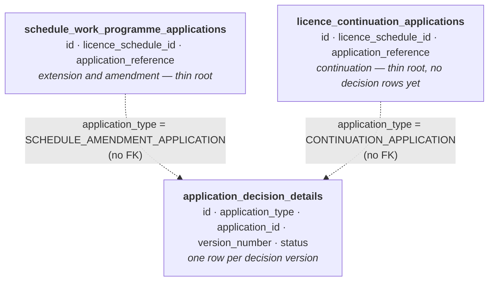

# Application Decisions Data Model

How the Licensing Management Service (LMS) records that a regulator has started deciding a
licence application, what is written to the database when a decision is started and submitted,
how decisions are versioned, and the enumerated values that appear in the data.

This document describes the *database* behaviour only. It assumes no access to the LMS
codebase. All table and column names below are the live PostgreSQL names.

It is the companion to `licence-applications-data-model.md`, which covers the two application
types, their versions, and the `swp_record_of_decision*` tables that hold the detail of an
extension and amendment decision. Read that first: a decision belongs to an application, and
the application tables are where its status and content live.

---

## 1. Vocabulary

| Term | Meaning |
|---|---|
| **Application** | A request from a licensee to change something about a licence — either an extension and amendment application (`schedule_work_programme_applications`) or a continuation application (`licence_continuation_applications`). |
| **Application detail** | One version of an application. There is one until an update is requested. See `licence-applications-data-model.md`. |
| **Decision detail** | The row created when a regulator starts recording a decision on an application. It holds the decision's own status, version and who started it, not the outcome. Lives in `application_decision_details`. |
| **Decision version** | One decision detail row. An application's first decision is version 1; a changed decision would be a new, higher version (§3.5). |
| **Record of decision** (ROD) | The outcome of an extension and amendment application — what was granted, rejected or amended. Lives in the `swp_record_of_decision*` tables, documented in `licence-applications-data-model.md`. |

---

## 2. How the tables fit together

```
schedule_work_programme_applications        licence_continuation_applications
                (id UUID)                                  (id UUID)
                    ▲                                           ▲
                    └──────────── application_type ─────────────┘
                                + application_id
                                  (no FK)
                                     │
                         application_decision_details
```

- `application_decision_details` serves **both** application types. Which root table a row
  belongs to is given by `application_type`, not by the column name.
- It is keyed on the **application**, not the application detail, so a decision detail is not
  tied to any one application version.
- There is no foreign key to either root table.

### 2.1 Entity relationship diagram

Read top to bottom: each layer is keyed on the layer above it.



---

## 3. `application_decision_details`

```
id                UUID        PK
application_type  TEXT        NOT NULL ← §4.2
application_id    UUID        NOT NULL (no FK)
version_number    INTEGER     NOT NULL
status            TEXT        NOT NULL ← §4.1
created_datetime  TIMESTAMPTZ NOT NULL
created_by_wua_id BIGINT      NOT NULL
```

Unique on `(application_type, application_id, version_number)`.

### 3.1 When a row is written

A row is written, with `status = 'DRAFT'`, at the moment a regulator starts recording a
decision on an extension and amendment application. At that point the application detail is
in status `DSP_UPLOADED`.

No continuation application gets a row. The `CONTINUATION_APPLICATION` value is allowed by
the design of the table but is not written.

### 3.2 What starting a decision writes

| | |
|---|---|
| Writes | One `application_decision_details` row with `status = 'DRAFT'`, the next `version_number` (§3.5), `created_datetime` set to the time it was started, and `created_by_wua_id` set to the regulator who started it |
| Writes | `status = 'DRAFT_DECISION'` on the application's **latest application detail that is not `DELETED`** — the highest `version_number` among its non-`DELETED` detail rows. No other detail row is changed |
| Writes | A "Draft decision started" case event (`case_events.event_type = 'DRAFT_DECISION_STARTED'`) against the application, attributed to the regulator who started it, with no payload |
| Does not write | Any `swp_record_of_decision*` row. Those are written only when the regulator answers a question in the decision journey |

All three writes happen in one transaction, so a `DRAFT` decision row, a `DRAFT_DECISION`
application detail and the case event appear together or not at all. Starting a decision when
a `DRAFT` row already exists (§3.3) writes none of them, so revisiting the start page does not
add a second event.

### 3.3 At most one draft per application

Starting a decision on an application that already has a `DRAFT` row reuses that row rather
than writing a second one. This is enforced in application code, not by a database
constraint, so two `DRAFT` rows for the same application are a data-quality signal.

### 3.4 Submitting the decision

When the regulator submits the decision from the review page, the application's `DRAFT` row is
updated to `status = 'COMPLETED'` in the same transaction that moves the application detail
`status` from `DRAFT_DECISION` to `ISSUE_DECISION`. So for an extension and amendment
application the two always agree:

| Application detail `status` | Expected `application_decision_details` rows |
|---|---|
| `DSP_UPLOADED` | none |
| `DRAFT_DECISION` | exactly one `DRAFT` |
| `ISSUE_DECISION` or later | the latest version `COMPLETED` — or no row at all, for a decision submitted before this table existed |

In the same transaction, a "Decision recorded" case event (`case_events.event_type =
'DECISION_RECORDED'`) is recorded against the application, attributed to the submitting user,
with no payload. Like the other case events it belongs to the application rather than to an
application version or a decision version, so a later decision version would add a second
event rather than replace this one.

Submitting fails, and nothing is written, if the application has no `DRAFT` row. No other
column changes on submission — there is no completed timestamp or completed-by user on this
table; use the audit table (§6) for those.

### 3.5 Versions

`version_number` counts the decisions recorded against an application, starting at 1. A new
`DRAFT` row takes one more than the highest `version_number` the application already has, of
any status. The design anticipates a recorded decision being changed later, which will write
a new version rather than editing the `COMPLETED` row.

Nothing changes a recorded decision yet, so today **every row has `version_number = 1`**.
Uniqueness of the version per application is guaranteed by the schema; that only the highest
version is current is a convention, not something any column records.

---

## 4. Enumerated values

All enums are persisted as their constant name in a `TEXT` column — no numeric codes, no
lookup tables, no database `CHECK` constraints or `ENUM` types. The lists below describe what
the service writes, not what the schema guarantees; a value outside them is a data-quality
signal, not a documentation gap.

### 4.1 `status`

| Value | When it applies |
|---|---|
| `DRAFT` | The regulator has started recording a decision and has not yet submitted it |
| `COMPLETED` | The regulator has submitted the decision from the review page (§3.4) |

### 4.2 `application_type`

| Value | Display | `application_id` points at |
|---|---|---|
| `SCHEDULE_AMENDMENT_APPLICATION` | Licence and work programme extension and amendment application | `schedule_work_programme_applications.id` |
| `CONTINUATION_APPLICATION` | Licence continuation application | `licence_continuation_applications.id` — not yet written |

---

## 5. Caveats and known gotchas

### 5.1 Join on both key columns, and use a left join

`application_id` identifies an application only together with `application_type`; on its own
it could in principle match a row in either root table. There is no foreign key, so a dangling
id is possible in principle.

An application can have more than one version (§3.5), so join to the latest one when you want
a single row per application:

```sql
SELECT a.application_reference, d.version_number, d.status, d.created_datetime
FROM schedule_work_programme_applications a
LEFT JOIN application_decision_details d
  ON d.application_type = 'SCHEDULE_AMENDMENT_APPLICATION'
 AND d.application_id = a.id
 AND d.version_number = (
       SELECT MAX(latest.version_number)
       FROM application_decision_details latest
       WHERE latest.application_type = d.application_type
         AND latest.application_id = d.application_id
     );
```

### 5.2 There is no direct link to the record of decision tables

The `swp_record_of_decision*` tables are keyed on the application **detail**
(`schedule_work_programme_application_detail_id`); `application_decision_details` is keyed on
the application. To pair a decision detail with its record of decision rows, go through
`schedule_work_programme_application_details.schedule_work_programme_application_id`.

### 5.3 The decision row holds status, not the outcome

`status = 'DRAFT'` means only that a regulator started the decision journey, and `COMPLETED`
only that they submitted it. Neither says what was decided: the outcome is in the
`swp_record_of_decision*` tables, and the decision date the regulator enters is
`schedule_work_programme_application_details.decision_date`.

### 5.4 When a decision was completed is only in the audit table

`created_datetime` and `created_by_wua_id` describe the start of the decision. Submitting it
changes only `status`, so "when was this decision completed, and by whom" is answered from
the `revtype = 1` revision in `application_decision_details_aud` that set `status` to
`COMPLETED` (§6).

### 5.5 User identifiers are external

`created_by_wua_id` is an Energy Portal web user account id. LMS stores no names or email
addresses for it — it is resolved from the Energy Portal at render time. It is written
directly when the row is created, so it is never null.

### 5.6 Decision versions and application versions are numbered independently

`application_decision_details.version_number` has no relationship to
`schedule_work_programme_application_details.version_number`. Decision version 1 can sit
alongside application version 2, and the `DRAFT_DECISION` status is written only to the
latest non-`DELETED` application detail, not to every version of the application (§3.2).

---

## 6. Audit history (Hibernate Envers)

`application_decision_details` has a parallel audit table, `application_decision_details_aud`,
holding the same data columns plus:

- `rev` — revision number, FK to `audit_revisions.rev`
- `revtype` — `0` = insert, `1` = update, `2` = delete

Revision metadata lives in the shared `audit_revisions` table, which records when each change
was made (`created_date_time`) and by whom (`user_wua_id`, `proxy_user_wua_id`).

---

## 7. Reference: current columns per table

**`application_decision_details`**
`id`, `application_type`, `application_id`, `version_number`, `status`, `created_datetime`,
`created_by_wua_id`
