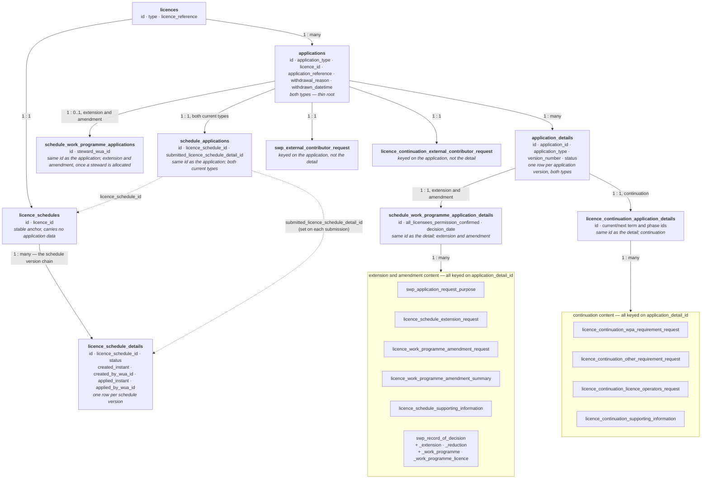

# Licence Applications — Extension and Amendment, and Continuation Data Model

How the Licensing Management Service (LMS) stores the two kinds of licence application
industry can submit against a licence schedule — the **extension and amendment application**
and the **continuation application** — what happens in the database as an application is
started, submitted and decided, and the enumerated values that appear in the data.

This document describes the *database* behaviour only. It assumes no access to the LMS
codebase. All table and column names below are the live PostgreSQL names.

It is the companion to `licence-schedules-data-model.md`, which covers the schedule itself.
Read that first: applications are anchored to schedules, and the single most important fact
about schedules — that **every change produces a brand-new set of rows for the whole
schedule** — governs how application rows point at schedule rows (§7).

---

## 1. Vocabulary

| Term | Meaning |
|---|---|
| **Application** | A request from a licensee to change something about a licence. LMS has exactly two types (§3). |
| **Extension and amendment application** (EAA) | "I want to extend a term, phase or work programme activity due date, or amend a work programme activity." An `applications` row with `application_type = 'SCHEDULE_AMENDMENT_APPLICATION'`. Referred to in code and table names as *SWP* (schedule work programme). |
| **Continuation application** (CA) | "I want to continue into the next term or phase of my production licence." An `applications` row with `application_type = 'CONTINUATION_APPLICATION'`. |
| **Application version** (a.k.a. *application detail*) | The mutable part of an application — status, timestamps, responsible organisation, and all the answers given in the journey. One `application_details` row per version; there is one until an update is requested (§11.1). |
| **Request** | A single thing being asked for within an application — one term extension, one work programme activity amendment, one requirement answer. Each has its own table. |
| **Record of decision** (ROD) | The regulator's recorded outcome for an extension and amendment application. Lives in the `swp_record_of_decision*` tables (§5.7). |
| **Steward** | The NSTA user allocated to progress an extension and amendment application. `schedule_work_programme_applications.steward_wua_id`; the row exists only once a steward has been allocated. |

Three structural facts drive almost every query:

1. **Both application types share two central tables.** `applications` and `application_details`
   hold every column the two types have in common, with an `application_type` column saying
   which type a row is. Columns only one type uses live in that type's own table, which shares
   its id with the central row (§2).
2. **The application row is thin; the detail row holds the state.** This mirrors the
   `licence_schedules` / `licence_schedule_details` split, but for a different reason — here
   the application exists to carry the application reference, the licence and the schedule
   binding, which must not change once set.
3. **Application rows point at *version-specific* schedule rows.** A term id, phase id or work
   programme activity id held on an application row belongs to one `licence_schedule_details`
   version. §7 explains what to do about that.

---

## 2. How the tables fit together

```
       licences (id INTEGER) ───────────────────────────┐
              │  1 : 1                                  │ 1 : many
              ▼                                         ▼
       licence_schedules ◄──── schedule_applications ── applications (application_type)
       (id UUID, licence_id)   (same id as the            │      │
              │ 1 : many        application)              │      └── schedule_work_programme_applications
              ▼                                           │          (same id; extension and amendment
       licence_schedule_details                           │           only, once a steward is allocated)
       (the version chain)                                ▼ 1 : many
                                                  application_details (application_type)
                                                          │
                                  ┌───────────────────────┴───────────────────────┐
                                  ▼ same id                                       ▼ same id
             schedule_work_programme_application_details   licence_continuation_application_details
                                  │                                               │
                                  ▼                                               ▼
                       request + decision tables (§5)                requirement tables (§6)
```

- Every application, of either type, is one `applications` row and one or more
  `application_details` rows. `application_type` on both says which type it is (§3).
- Columns that only one type uses live in a **type-specific table that shares its id** with the
  central row: an extension and amendment detail's extra columns are in
  `schedule_work_programme_application_details`, a continuation detail's in
  `licence_continuation_application_details`, under the same id as the `application_details`
  row. Continuation applications have no extra application-level columns, so there is no
  continuation table at that level.
- Every application has a licence (`applications.licence_id`). Applications that relate to a
  licence schedule, which today is both types, also have a `schedule_applications` row, under
  the same id, holding the schedule and `submitted_licence_schedule_detail_id`, a nullable
  pointer to the schedule version the application was most recently submitted against (§7.1). The
  schedule hangs off `licence_schedules`, **not** off a schedule version. A licence with no
  schedule cannot have either type of application.
- Every journey answer lives in a child table keyed on the **application detail** id, except
  the two external contributor tables, which key on the **application** id so that a team and
  its membership survive across application versions (§9). Child tables keyed on a detail
  point at the type-specific detail table, so a continuation answer can only belong to a
  continuation detail.

### 2.1 Entity relationship diagram

Read top to bottom: each layer is keyed on the layer above it.



---

## 3. The two application types

The application type is stored as `TEXT` in `applications.application_type` and repeated in
`application_details.application_type`. The two always agree: `application_details` has a
composite foreign key on `(application_id, application_type)` to `applications (id,
application_type)`. The same string also appears outside these tables, in the team scope
(§9), the document instance item type (§10), `application_decision_details` and the licence
event cache.

| Value | Display | Reference prefix | Type-specific detail table | Licence types that can start one |
|---|---|---|---|---|
| `SCHEDULE_AMENDMENT_APPLICATION` | Licence and work programme extension and amendment application | `LMS/EAA/` | `schedule_work_programme_application_details` | Landward production, Seaward production, Carbon storage |
| `CONTINUATION_APPLICATION` | Licence continuation application | `LMS/CA/` | `licence_continuation_application_details` | Landward production, Seaward production |

Note the mismatch between the stored name and everything user-facing: the value is
`SCHEDULE_AMENDMENT_APPLICATION`, the reference prefix is `EAA`, the table prefix is `swp`,
and the display name is "extension and amendment". All four refer to the same thing.

Both types are additionally behind release feature flags, so availability in a given
environment is not a property of the data.

---

## 4. Application status — the lifecycle both types share

`status` is stored as `TEXT` on `application_details`, from one value set shared by both
types:

| Value | Meaning | Searchable in the work area |
|---|---|---|
| `DRAFT` | Being built by the licensee. Not visible to the regulator. | Yes |
| `SUBMITTED` | Submitted to the NSTA and under assessment. | Yes |
| `DSP_UPLOADED` | The signed decision support paper has been uploaded; the application is ready for a decision to be recorded. The paper can still be replaced in this status and in `DRAFT_DECISION` (see below). | Yes |
| `DRAFT_DECISION` | A regulator has started recording the decision but has not yet submitted it. See `application-decisions-data-model.md`. | Yes |
| `ISSUE_DECISION` | A decision has been recorded and the decision letter is being prepared or issued. | Yes |
| `COMPLETE` | The decision letter has been issued. | Yes |
| `WITHDRAWN` | Withdrawn after submission, with a reason. | Yes |
| `DELETED` | An abandoned draft. **The rows are not physically deleted** — the status is flipped and everything stays in place. | No |

```
      (licensee starts an application)
                  │
                  ▼
                DRAFT ──────── abandon ────────► DELETED
                  │
                  │ submit  (reference + schedule binding assigned here)
                  ▼
              SUBMITTED ─────── withdraw ───────► WITHDRAWN
                  │
                  │ upload DSP  (extension and amendment only)
                  ▼
             DSP_UPLOADED
                  │
                  │ start recording the decision  (extension and amendment only)
                  ▼
            DRAFT_DECISION
                  │
                  │ submit the recorded decision
                  ▼
            ISSUE_DECISION
                  │
                  │ issue letter
                  ▼
               COMPLETE
```

**Correcting a DSP.** While an extension and amendment application detail is in `DSP_UPLOADED`
or `DRAFT_DECISION` the uploaded DSP can be replaced, for example when the wrong document was
uploaded. The replacement does not move the status, so the row stays in its current status, and
it does not change `decision_date` or any recorded decision answer. The replaced file is kept
and re-filed as superseded (section 10), and the corrected file is filed in its place, so there
is only ever one current DSP. A "DSP corrected" case event
(`case_events.event_type = 'DSP_CORRECTED'`) is recorded against the application, attributed to
the user who made the correction. Its payload is JSON with `type` `dsp-corrected`, `replacedFileIds`
and `correctedFileIds`, and the case events tab shows each file as a download link. Once the
decision has been submitted (`ISSUE_DECISION`) the DSP can no longer be replaced.

**The two families do not use the same portion of this lifecycle.**

| Status | Extension and amendment | Continuation |
|---|---|---|
| `DRAFT` | yes | yes |
| `SUBMITTED` | yes | yes |
| `DSP_UPLOADED` | yes — set when the signed DSP is uploaded | **never set** |
| `DRAFT_DECISION` | yes — set on the latest non-`DELETED` application version when a regulator starts recording the decision | **never set** |
| `ISSUE_DECISION` | yes — set when the recorded decision is submitted | yes — set when the decision is confirmed, straight from `SUBMITTED` |
| `COMPLETE` | **never set** | yes — set when the continuation letter is issued |
| `WITHDRAWN` | **never set** | yes |
| `DELETED` | yes | yes |

An extension and amendment application therefore terminates at `ISSUE_DECISION` today. Do not
read the absence of `COMPLETE` rows on that side as a data problem, and do not build a
"completed applications" report that assumes both families reach the same terminal state.

`DELETED` rows are abandoned drafts that were never submitted. Exclude them from reporting;
they are dead weight, not history.

Uploading the decision support paper on an extension and amendment application moves the
application detail from `SUBMITTED` to `DSP_UPLOADED` and records a "DSP uploaded" case event
(`case_events.event_type = 'DSP_UPLOADED'`) against the application, attributed to the user who
uploaded it. The event payload is JSON with `type` `dsp-uploaded` and `fileIds`, the ids of the
uploaded DSP files; the case events tab shows each as a download link.

---

## 5. Extension and amendment application

### 5.1 The application and detail rows

An extension and amendment application is spread over the central tables, shared with
continuation applications, and its own type-specific tables, joined on id:

```
applications                                          (both types)
  id                                   UUID PK
  application_type                     TEXT NOT NULL  'SCHEDULE_AMENDMENT_APPLICATION'
  licence_id                           INTEGER NOT NULL → licences.id  (the schedule's licence, §11.3)
  application_reference                TEXT           UNIQUE, null until submission
  withdrawal_reason                    TEXT           always null for this type today (§4)
  withdrawn_datetime                   TIMESTAMPTZ    always null for this type today (§4)

schedule_applications                                 (same id as the application)
  id                                   UUID PK → applications.id
  licence_schedule_id                  UUID NOT NULL → licence_schedules.id
  submitted_licence_schedule_detail_id UUID          → licence_schedule_details.id  (null until first submission)

schedule_work_programme_applications                  (same id as the application)
  id                                   UUID PK → applications.id
  steward_wua_id                       BIGINT NOT NULL Energy Portal wua id
```

`schedule_work_programme_applications` holds the columns only extension and amendment
applications have, which today is just the steward. **A row exists only once a steward has been
allocated**, and reallocating updates it in place. No row means no steward: join to it with a
left join.

```
application_details                                   (both types)
  id                                   UUID PK
  application_id                       UUID NOT NULL  → applications.id
  application_type                     TEXT NOT NULL  'SCHEDULE_AMENDMENT_APPLICATION'
  version_number                       INTEGER        1 until an update is requested (§11.1)
  status                               TEXT           §4
  created_datetime                     TIMESTAMPTZ NOT NULL
  created_by_wua_id                    BIGINT         Energy Portal wua id of the creator (§11.9)
  submitted_datetime                   TIMESTAMPTZ    null until submission
  submitted_by_wua_id                  BIGINT         null until submission
  responsible_organisation_unit_id     INTEGER        Energy Portal organisation unit
  update_deadline_date                 DATE           date an update was requested by (§11.1); null if none requested
  update_reason                        TEXT           why an update was requested (§11.1); null if none requested

schedule_work_programme_application_details           (same id as the application detail)
  id                                   UUID PK → application_details.id
  all_licensees_permission_confirmed   BOOLEAN        captured on the first page of the journey
  decision_date                        DATE           set when the final decision is recorded
```

Every extension and amendment detail has a row in both detail tables. Starting an application
inserts the `applications`, `schedule_applications`, `application_details` and
`schedule_work_programme_application_details` rows, plus a scoped external contributors team
(§9). The schedule version the licence had `ACTIVE` at that moment is *not* recorded yet —
only `licence_schedule_id` is, which is the stable anchor, not a version.

### 5.2 `swp_application_request_purpose` — what is being asked for

One row per application detail, written at the first journey step.

```
id                                            UUID PK
application_detail_id                         UUID → schedule_work_programme_application_details.id
extend_phase_or_term                          BOOLEAN NOT NULL
extend_term                                   BOOLEAN NOT NULL
amend_work_programme                          BOOLEAN NOT NULL
```

The three booleans are independent checkboxes, not a single choice, and which of them are
*offered* depends on the licence type:

| Option | Column | Offered when |
|---|---|---|
| Extend a phase or term | `extend_phase_or_term` | the licence type has terms **and** captures phases |
| Extend a term | `extend_term` | the licence type has terms but does **not** capture phases |
| Amend the work programme | `amend_work_programme` | the licence type has a work programme **and** the schedule has at least one current work programme activity |

`extend_phase_or_term` and `extend_term` are therefore mutually exclusive by construction — a
licence type offers one or the other, never both. A row with both set is malformed.

### 5.3 `licence_schedule_extension_request` — requested extensions

One row per term or phase the licensee wants extended.

```
id                                             UUID PK
application_detail_id                          UUID NOT NULL
term_id                                        UUID   → a licence_schedule_terms row   (no FK)
phase_id                                       UUID   → a licence_schedule_phases row  (no FK)
extension_duration_days                        INTEGER NOT NULL
extension_duration_months                      INTEGER NOT NULL
extension_duration_years                       INTEGER NOT NULL
```

- Exactly one of `term_id` / `phase_id` is populated per row; the other is null.
- The duration is a **calendar** duration held as three integers, the same convention used
  throughout the schedule model. It cannot be flattened to a day count without losing meaning.
- There is at most one row per application detail per term and per phase, but this is enforced
  in application code only — unlike the decision-side equivalents, which do have partial
  unique indexes (§5.7).
- Deleting an extension request from a draft physically deletes the row.

### 5.4 `licence_work_programme_amendment_request` — requested work programme amendments

One row per work programme activity the licensee wants amended.

```
id                                              UUID PK
application_detail_id                           UUID NOT NULL
work_programme_activity_id                      UUID   → a work_programme_activities row (no FK)
work_programme_completion_date_change_requested  BOOLEAN
work_programme_extension_duration_days           INTEGER
work_programme_extension_duration_months         INTEGER
work_programme_extension_duration_years          INTEGER
work_programme_change_requested                 BOOLEAN
work_programme_amendment_information             TEXT
```

The two booleans gate the fields below them:

| Boolean | When true | When false |
|---|---|---|
| `work_programme_completion_date_change_requested` | the three `work_programme_extension_duration_*` columns carry the requested extension | expect those three columns null |
| `work_programme_change_requested` | `work_programme_amendment_information` carries the free-text description of the change wanted | expect that column null |

At least one of the two is true on a saved row — an amendment request that asks for neither a
date change nor a text change is malformed. Both may be true at once.

### 5.5 `licence_work_programme_amendment_summary` — "anything else?"

One row per application detail, recording the licensee's answer to whether more amendments are
coming.

```
id                                                UUID PK
application_detail_id                             UUID NOT NULL
licence_work_programme_amendment_summary_options   TEXT   ← §8.2
```

`YES_LATER` is the value that matters for reporting: it marks an application the licensee
intends to add to, and it is the answer that keeps the section incomplete on the task list.

### 5.6 `licence_schedule_supporting_information` — the narrative

One row per application detail. Four free-text fields, all nullable.

```
id                                             UUID PK
application_detail_id                          UUID NOT NULL
licence_progress                               TEXT
reason_for_amendment                           TEXT
plan_during_extension                          TEXT
impact_on_deliverables                         TEXT
```

Supporting **documents** are not in this table — see §10.

### 5.7 Record of decision

The regulator's outcome is recorded across five tables. All are keyed on the application
detail by `application_detail_id`, which points at `schedule_work_programme_application_details`.

**`swp_record_of_decision`** — one row per application detail, the headline outcome.

```
id                                            UUID PK
application_detail_id                         UUID NOT NULL
extension_decision                            TEXT   ← §8.3
work_programme_decision                       TEXT   ← §8.3
work_programme_summary_option                 TEXT   ← §8.4
```

Both decision columns use the same three-value set, and `NOT_REQUESTED` is the value to expect
where the licensee did not ask for that kind of change at all. So a null decision means "not
yet recorded"; `NOT_REQUESTED` means "recorded, and there was nothing to decide".

**`swp_record_of_decision_extension`** and **`swp_record_of_decision_reduction`** — the
per-term and per-phase durations the NSTA actually granted. Identical shape apart from the
duration column prefix:

```
id                                            UUID PK
application_detail_id                         UUID NOT NULL
term_id                                       UUID   (no FK)
phase_id                                      UUID   (no FK)
extension_duration_days / _months / _years    INTEGER NOT NULL   (reduction_duration_* on the reduction table)
```

Both carry **partial unique indexes** on `(application detail, term_id) WHERE term_id IS NOT
NULL` and `(application detail, phase_id) WHERE phase_id IS NOT NULL`. So unlike the request
side, at most one extension row and one reduction row per term or phase per application is
guaranteed by the schema.

Unlike the request side, `term_id` / `phase_id` here point at the licence's **currently
`ACTIVE`** schedule version as of the last time the decision was saved, not at the submitted
version (§7.4). A row saved before a later schedule update still points at the older version
until the decision is saved again. The unique indexes are on the id, so across versions it is
application code — matching rows on `schedule_events.original_event_id` when re-saving — that
keeps it to one row per logical term or phase, not the schema.

The regulator chooses one of three outcomes per term or phase, and the choice is expressed by
*which table holds a row*, not by a stored value:

| Choice | Result in the database |
|---|---|
| Extend | a row in `swp_record_of_decision_extension` |
| Reduce | a row in `swp_record_of_decision_reduction` |
| Maintain | **no row in either table** |

"Maintain" is therefore indistinguishable from "not yet decided" at row level. Use
`swp_record_of_decision.extension_decision` being non-null to establish that the decision was
made, then the absence of rows to establish which items were maintained. A term or phase with
a row in *both* tables is malformed.

**`swp_record_of_decision_work_programme`** — one row per work programme activity decided.

```
id                                            UUID PK
application_detail_id                         UUID NOT NULL
work_programme_activity_id                    UUID NOT NULL → work_programme_activities.id  (FK enforced here)
decision                                      TEXT NOT NULL ← §8.5
amend_duration                                BOOLEAN
amend_text                                    BOOLEAN
amended_duration_days / _months / _years      INTEGER
amended_text                                  TEXT
```

Unique on `(application detail, work programme activity)`. The `amend_*` booleans gate the
columns below them exactly as on the request side (§5.4), and are only meaningful when
`decision = 'AMEND'`.

**`swp_record_of_decision_work_programme_licence`** — the licences a commitment was moved to.

```
id                                   UUID PK
record_of_decision_work_programme_id UUID NOT NULL → swp_record_of_decision_work_programme.id
licence_id                           INTEGER NOT NULL → licences.id
```

Unique on the pair. Populated only for `decision = 'COMPLETE_ON_ANOTHER_LICENCE'`; a
commitment can move to more than one licence, hence a child table rather than a column.

While the application is in `DRAFT_DECISION`, a work programme decision can be changed or
removed. Changing it updates the existing `swp_record_of_decision_work_programme` row in place.
Removing it physically deletes that row and its `swp_record_of_decision_work_programme_licence`
rows. When the last row for an application detail is removed,
`swp_record_of_decision.work_programme_summary_option` is set back to null (§8.4); removing one
of several leaves it as it was.

### 5.8 What the decision does *not* do

**Recording a decision does not change the licence schedule.** Nothing in the decision tables
writes back to `licence_schedule_terms`, `licence_schedule_phases` or
`work_programme_activities`, and no new `licence_schedule_details` version is created as a
result. A granted extension exists in the decision tables and in the issued letter; applying
it to the live schedule is a separate manual "update an existing licence schedule" journey
performed by a Licence Management user.

The practical consequence: **`swp_record_of_decision_extension` is a record of intent, not a
record of what the schedule says.** Do not reconcile the two by assuming they must agree, and
do not compute current term end dates from decision rows.

---

## 6. Continuation application

### 6.1 The application and detail rows

A continuation application uses the same central rows as an extension and amendment
application (§5.1), with `application_type = 'CONTINUATION_APPLICATION'`:

- one `applications` row. `withdrawal_reason` and `withdrawn_datetime` are set when it is
  withdrawn.
- one `schedule_applications` row, under the same id, with the schedule and
  `submitted_licence_schedule_detail_id`.
- one `application_details` row per version.

It has no application-level columns of its own, so there is no continuation table at that
level. Each version also has a row in its type-specific detail table:

```
licence_continuation_application_details              (same id as the application detail)
  id                                  UUID PK → application_details.id
  current_term_id                     UUID → licence_schedule_terms.id   (FK enforced)
  current_phase_id                    UUID → licence_schedule_phases.id  (FK enforced)
  next_term_id                        UUID → licence_schedule_terms.id   (FK enforced)
  next_phase_id                       UUID → licence_schedule_phases.id  (FK enforced)
```

The four term and phase columns are a **snapshot of the schedule state taken at submission**
(§7.2). They are null on a draft. Any of the four may legitimately be null even after
submission — a licence in its final term has no next term, and a licence type that does not
capture phases has neither phase.

Which term or phase is "current" is evaluated as `start_date <= today AND end_date > today` —
start inclusive, end exclusive, the same rule the schedule model uses throughout.

### 6.2 `licence_continuation_wpa_requirement_request` — work programme readiness

One row per application detail.

```
id                                            UUID PK
application_detail_id                         UUID → licence_continuation_application_details.id
work_programme_activities_completion_status   BOOLEAN   have all activities been completed?
actions_to_complete_work_programme_activities TEXT      required when the above is false
further_information                           TEXT
```

### 6.3 `licence_continuation_other_requirement_request` — the conditional requirements

One row per application detail, holding up to three yes/no + explanation pairs.

```
id                                            UUID PK
application_detail_id                         UUID
financial_capacity_evidence_submission_status BOOLEAN
actions_to_provide_financial_evidence         TEXT
development_consent_grant_status              BOOLEAN
actions_to_approve_development_consent        TEXT
relinquishment_requirement_status             BOOLEAN
actions_to_relinquish_required_licence_area   TEXT
```

**Which of the three pairs is asked for depends on the schedule, not the licence type**, and
all three are driven off the *next* term or phase — the one being continued into:

| Requirement | Shown when |
|---|---|
| Financial capacity | the next phase is `PHASE_C`, or the next term is `SECOND` or `THIRD` |
| Development consent | the next term is `THIRD` |
| Relinquishment | the schedule has a `MANDATORY_RELINQUISHMENT` other schedule event falling within the relevant schedule window |

So nulls in this table are the normal case, and a null does not mean an unanswered question —
it usually means the question was never asked. Reconstructing which questions *were* asked
requires the schedule state, and for submitted applications that is the snapshot on the detail
row (§6.1), not the schedule as it stands today.

### 6.4 `licence_continuation_licence_operators_request` — pending actions

One row per application detail — modelled as a one-to-one in the application, though no unique
constraint enforces it.

```
id                                         UUID PK
application_detail_id                      UUID
pending_actions_explanation                TEXT
```

### 6.5 `licence_continuation_supporting_information`

One row per application detail.

```
id                                         UUID PK
application_detail_id                      UUID
has_additional_supporting_information      BOOLEAN
```

A boolean only. The documents themselves are in the file upload library (§10), so
`has_additional_supporting_information = true` with no uploaded files is a data-quality signal
rather than a contradiction the schema prevents.

Continuation applications also record whether external contributors were invited, but that
answer is keyed on the application rather than the application detail, so it is covered
alongside its extension and amendment twin in §9.

---

## 7. How applications bind to a schedule

### 7.1 `submitted_licence_schedule_detail_id`

`schedule_applications.submitted_licence_schedule_detail_id` is null until the application is
first submitted. On **every** submission, the first and each update submission, both types set
it to the schedule version that is `ACTIVE` for the licence **at that moment**.

It is held once per application, not per version, so each resubmission overwrites it. Every
version of the application, including earlier submitted ones, is then read against the
schedule version of the latest submission. The column does not record which schedule version an
earlier submission was made against; for that, use the history in `schedule_applications_aud`
(§12). Continuation's term and phase snapshot is held per version and is not overwritten (§7.2).

This gives the correct rule for resolving an application's schedule, for either type:

```sql
-- the schedule version an application should be read against
SELECT COALESCE(
         sa.submitted_licence_schedule_detail_id,
         (SELECT lsd.id
            FROM licence_schedule_details lsd
           WHERE lsd.licence_schedule_id = sa.licence_schedule_id
             AND lsd.status = 'ACTIVE')
       ) AS schedule_detail_id
FROM schedule_applications sa
WHERE sa.id = :application_id;
```

That is: **use the submitted version if there is one, otherwise the currently active
version.** An application that has never been submitted moves with the licence's live
schedule. Once submitted, it stays on that version, even after the licence's schedule is updated
several times over, until it is next submitted. An update draft therefore reads against the
version of the previous submission, not the live schedule, until it is resubmitted. The one
exception is the record of decision on an extension and amendment application, which reads the
currently active version instead (§7.4).

### 7.2 Why continuation also snapshots term and phase

The continuation detail's `current_term_id` / `current_phase_id` / `next_term_id` /
`next_phase_id` are populated at submission from the schedule state of that same active
version. They are a convenience snapshot: the rows they point at belong to the submitted
schedule version and remain readable after that version becomes `REPLACED`.

The extension and amendment side has no equivalent — it re-derives what it needs from
`submitted_licence_schedule_detail_id` each time, except when recording the decision (§7.4).

### 7.3 Following an application's targets across schedule versions

`licence_schedule_extension_request.term_id`, `.phase_id` and
`licence_work_programme_amendment_request.work_programme_activity_id` all point at rows
belonging to **one schedule version**. When the licence schedule is next updated, those rows
are copied to a new version with fresh ids, and the application keeps pointing at the old
ones — which still exist, under a `REPLACED` version.

To follow the same logical schedule event, go via `schedule_events.original_event_id`, exactly
as described in the schedule data model:

```sql
-- what does the amendment request's activity look like in the CURRENT schedule?
SELECT cur.category, cur.commitment, cur.due_date
FROM licence_work_programme_amendment_request req
JOIN schedule_events se_req ON se_req.id = req.work_programme_activity_id
JOIN schedule_events se_cur ON se_cur.original_event_id = se_req.original_event_id
JOIN work_programme_activities cur ON cur.id = se_cur.id
JOIN licence_schedule_details lsd ON lsd.id = cur.licence_schedule_detail_id
WHERE req.id = :request_id
  AND lsd.status = 'ACTIVE';
```

This can legitimately return no rows: the activity may have been deleted from the schedule in
a later version while the application still references it.

### 7.4 The record of decision reads the current schedule

When the regulator records a decision on an extension and amendment application, the terms,
phases and work programme activities offered — and the current durations and end dates shown
against them — come from the licence's schedule version that is `ACTIVE` at that moment, not
from `submitted_licence_schedule_detail_id`. Nothing about the current dates is stored; they
are read from the active version each time.

So the ids written to the decision tables belong to whichever version was active when the
row was saved:

| Column | Points at |
|---|---|
| `swp_record_of_decision_extension.term_id` / `.phase_id` | the active version when the decision was last saved |
| `swp_record_of_decision_reduction.term_id` / `.phase_id` | the active version when the decision was last saved |
| `swp_record_of_decision_work_programme.work_programme_activity_id` | the active version when the row was saved |

If the schedule is updated while a decision is part-recorded, extension and reduction rows are
matched to the new version by `schedule_events.original_event_id`. They are re-pointed at the
new version's term or phase the next time the durations are saved, and until then they
keep pointing at the old version. To find the current row for any of these ids, go via
`original_event_id` exactly as in §7.3. A row whose term or phase no longer exists in the
active version is removed the next time the durations are saved.

This means the request rows (§5) and the decision rows for the same application can point at
different schedule versions. Join on `original_event_id`, not on id, to line them up.

### 7.5 Application rows are never duplicated with the schedule

Every application-side table is explicitly excluded from the schedule duplication system. When
a new schedule version is created, none of the request, requirement or decision rows are
copied. Applications live entirely outside the schedule version chain and are unaffected by
it — which is exactly why §7.3 is needed.

---

## 8. Enumerated values

All enums are persisted as their **Java constant name in a `TEXT` column** — no numeric codes,
no lookup tables, no database `CHECK` constraints or `ENUM` types. Display strings are held in
code and are **not** present in the database. A value outside these lists is a data-quality
signal, not a documentation gap.

### 8.1 `application_details.status`

`DRAFT`, `SUBMITTED`, `DSP_UPLOADED`, `DRAFT_DECISION`, `ISSUE_DECISION`, `COMPLETE`, `WITHDRAWN`,
`DELETED` — see §4, including
which values each family actually uses.

### 8.2 `licence_work_programme_amendment_summary.licence_work_programme_amendment_summary_options`

| Value | Display |
|---|---|
| `YES_NOW` | Yes, I want to request to amend it now |
| `YES_LATER` | Yes, but I will request to amend it later |
| `NO` | No, I have requested to amend all work programme activities I need to |

### 8.3 `swp_record_of_decision.extension_decision` and `.work_programme_decision`

| Value | Display |
|---|---|
| `GRANTED` | Yes |
| `REJECTED` | No - not approved |
| `NOT_REQUESTED` | No - not requested |

### 8.4 `swp_record_of_decision.work_programme_summary_option`

| Value | Display |
|---|---|
| `YES_NOW` | Yes, I want to add it now |
| `NO_LATER` | No, I will add one later |
| `NO_ALL_ADDED` | No, I have added all work programme activities I need to |

Note this shares the value `YES_NOW` with §8.2 but is a different enum with different
remaining values — do not join or group the two columns together.

A null means the question has not been answered, or that every work programme decision was
removed after it was answered (§5.7). So a null here alongside no
`swp_record_of_decision_work_programme` rows is expected, not a gap in the data.

### 8.5 `swp_record_of_decision_work_programme.decision`

| Value | Display | Effect on the row |
|---|---|---|
| `AMEND` | Extend duration or text | `amend_duration` / `amend_text` and their fields populated |
| `WAIVE` | Waive | amendment fields null |
| `COMPLETE_ON_ANOTHER_LICENCE` | To be completed on another licence | one or more `swp_record_of_decision_work_programme_licence` rows |
| `ACKNOWLEDGE` | Acknowledge - no further action | amendment fields null |

### 8.6 Duration change type — **not stored**

The regulator's per-term choice of Maintain / Reduce / Extend has no column. It is expressed by
which of the two decision tables holds a row (§5.7). There is nothing to query for it directly.

### 8.7 Request purpose options — **not stored as an enum**

The three options (Extend a phase or term, Extend a term, Amend the work programme) are stored
as three booleans on `swp_application_request_purpose`, not as a value (§5.2).

---

## 9. External contributors

Both families let the licensee invite external contributors to help fill in the application.
The invitation itself is a **team**, not an application table:

```
teams
  id         UUID PK
  type       TEXT   ← EXTERNAL_CONTRIBUTORS
  scope_type TEXT   ← the application type name (§3)
  scope_id   TEXT   ← see below
```

`teams` is unique on `(type, scope_type, scope_id)` where `scope_type` is not null. Team
membership and roles (`EXTERNAL_APPLICATION_EDITOR`, `EXTERNAL_APPLICATION_VIEWER`) live in
the team role tables.

**`scope_id` is the application id in both families**, and `scope_type` is the application type
name:

| Family | `scope_type` | `scope_id` | Created when |
|---|---|---|---|
| Extension and amendment | `SCHEDULE_AMENDMENT_APPLICATION` | the application id | the application is created |
| Continuation | `CONTINUATION_APPLICATION` | the application id | the licensee information step is completed |

Scoping on the application rather than the application detail is what keeps a team and its
membership attached across application versions.

Each family also has a table holding the licensee's yes/no answer to "do you want to add
external contributors?". The two are the same shape, and both key on the application to match
the team:

```
swp_external_contributor_request
  id                        UUID PK
  application_id            UUID → applications.id
  add_external_contributors BOOLEAN

licence_continuation_external_contributor_request
  id                        UUID PK
  application_id            UUID → applications.id
  add_external_contributors BOOLEAN
```

These are the only application content tables keyed on the application rather than the
application detail. Joining either to its team means comparing that application id against
`teams.scope_id` for the matching `scope_type`.

Both point at `applications`, so the database does not check that a row in
`swp_external_contributor_request` belongs to an extension and amendment application, or one in
`licence_continuation_external_contributor_request` to a continuation application. That is
enforced in application code (§11.4).

The answer and the team move together in one direction only:

- `add_external_contributors = true` with an empty team is an ordinary in-progress state — the
  section simply is not finished yet. It becomes finished once the team has at least one
  member.
- Answering **no removes every member from the team**, but does not delete the team. An empty
  external contributors team is therefore the normal resting state for an application whose
  answer is `false`, and is not evidence that contributors were never added.

---

## 10. Files and decision letters

**No uploaded file is stored in an LMS-owned table.** Uploads go to the shared file upload
library, which keys each file by a `(usage_id, usage_type, document_type)` triple supplied by
LMS. The mapping is:

| Section | `usage_id` | `usage_type` |
|---|---|---|
| Extension and amendment — supporting documents | application **detail** id | `SCHEDULE-AMENDMENT-APP-SUPPORTING-DOCUMENT` |
| Extension and amendment — final decision support papers | application **detail** id | `FINAL-DECISION-SUPPORT-PAPER` |
| Continuation — other requirement documents | application **detail** id | `CONTINUATION-OTHER-REQUIREMENT-DOCUMENT` |
| Continuation — additional supporting documents | application **detail** id | `CONTINUATION-ADDITIONAL-SUPPORTING-DOCUMENT` |
| Continuation — issued letter | **application** id | `APPLICATION-CONTINUATION-LETTER` |

These five are the only usage types LMS writes. Historic rows may still carry a usage type no
longer in the list.

A final decision support paper that a correction has replaced keeps its usage id and usage type
but has `document_type` `superseded-final-decision-support-paper`; the current one has
`document_type` `final-decision-support-paper`.

Files filed under an application **detail** id for supporting documents and continuation
other requirement documents are copied, not moved, when a new detail version is created (see
section 11.1).

**Decision letters** are document instances in the shared document management library, keyed
by `item_reference` = the application id and `item_type` = the application type name. A
document instance is created at the point the decision is recorded (extension and amendment)
or confirmed (continuation) — i.e. on entry to `ISSUE_DECISION`. Templates are selected by
mnemonic:

| Family | Template type |
|---|---|
| Extension and amendment | `EXTENSION_APPROVAL_LETTER` |
| Continuation | `CONTINUATION_LETTER` |

`document_templates` is the one document table LMS owns; the instances are not in LMS tables.

---

## 11. Caveats and known gotchas

### 11.1 `version_number` is 1 until an update is requested

`application_details` carries `version_number`, and an application can have many detail rows.
Every application starts with exactly one detail row, `version_number` 1. A second row appears only
when a regulator requests an update to a `SUBMITTED` application (§11.1.1); nothing else
creates one. Queries that fetch "the latest detail by version number descending" are therefore
correct, and any query that assumes one detail row per application is wrong for applications
that have had an update requested — join to the detail table rather than assuming one row.

#### 11.1.1 Requesting an update

Requesting an update works the same way for both application types. It leaves the existing
`SUBMITTED` row exactly as it was and inserts a new `DRAFT` detail row for the same application:

- `version_number` is one higher than the highest stored version, including `DELETED` ones, so a number is never reused. It also gets a fresh `created_*` timestamp and user.
- The responsible organisation is carried over. A schedule detail also keeps
  `all_licensees_permission_confirmed`, and a continuation detail keeps the same current and
  next term and phase ids.
- `update_deadline_date` and `update_reason` hold the answers given when the update was
  requested. They are null on the earlier version. Whether a detail is an application update is
  decided by `version_number` (greater than 1), not by `update_deadline_date` being set.
- `submitted_*` and `decision_date` start empty.
- The child rows are copied field-for-field with fresh ids: for a schedule application, the
  request purpose, extension requests, amendment requests, amendment summary and supporting
  information; for a continuation application, the licence operators, WPA requirement, other
  requirement and supporting information rows. Record-of-decision rows and the external
  contributor requests are not copied. Uploaded files are copied too (see section 10): the
  new row gets its own copy of each supporting document (schedule application) or each other
  requirement and additional supporting document (continuation), filed under the new detail
  id, and the old version keeps its files. Decision support papers and the issued letter are
  not copied.
- An "Application update requested" case event is recorded against the application when the
  update is requested, attributed to the requesting user. The event's payload holds the
  update deadline and the update reason, and the case event card shows them as "Update
  deadline" and "Update reason". Like the application reference, the event belongs to the
  application rather than to a version, so it shows against every version. No case note is
  created.
- An "Application update requested" email is sent when the update is requested. It goes to the
  application submitters of the responsible organisation's group and to the licence contact
  for the responsible organisation on that licence. Addresses are compared case-insensitively,
  so someone who is both a submitter and the licence contact receives one email. If the
  organisation has no group, only the licence contact is notified. If there are no recipients
  at all, nothing is sent and a warning is logged. A failed send to one recipient is logged and
  does not stop the others or roll back the new draft.
- Submitting the update records an "Application update submitted" case event instead of the
  "Application submitted" event that the first submission records. Its payload holds the
  version number of the submitted detail, and the case event card shows it as "Version". Both
  application families record these events on submission.

An update cannot be requested on a version while the application has a later version that is
not `DELETED`. This is enforced in application code. In practice an application has at most one
open update request at a time: update drafts cannot be deleted, so a new request only becomes
possible once the draft created by the earlier one has been submitted and the application
moves on. The earlier `SUBMITTED` row keeps its status throughout, so a
`SUBMITTED` row with a later version is not the application's current version.

The next update takes the number after the highest stored version, so a number is never
reused. The pair (`application_id`, `version_number`) is unique in `application_details`, so
two versions of one application can never share a number.

While a draft update is open on a continuation application, the regulator cannot confirm the
continuation from the earlier version. Confirming is possible again on the updated version once
it has been submitted. The other actions (for example withdrawing) stay available. Withdrawing a continuation application
withdraws every version of it, including an open draft update, but not versions that were
already `DELETED`.

Note the side effect on application references: the running number counts *version 1* details
submitted in the calendar year, so it is effectively a count of distinct applications.

### 11.2 The application reference is assigned at submission, not creation

`application_reference` is null for every draft, and unique across `applications` once set. The
format is `LMS/EAA/{year}/{n}/1` and `LMS/CA/{year}/{n}/1`, where the trailing `1` is the
version number and `n` is one more than the number
of applications of that type submitted so far in the current calendar year. The counter
restarts each year, so the reference is only unique *with* its year component.

When an updated version is submitted, the application keeps its existing reference and only the
version suffix changes, to the submitted version's number: `LMS/EAA/2024/5/1` becomes
`LMS/EAA/2024/5/2` and then `LMS/EAA/2024/5/3`. Any earlier suffix is replaced rather than
stacked, and the running number is not advanced. Until the update is submitted, the reference
is unchanged. The reference lives on the application, so every version of that application,
including the original submitted one, shows the new reference once it is submitted.

Two consequences: a `DELETED` draft never consumes a number, and references are allocated at
submission time, so their order matches `submitted_datetime`, not the creation timestamp.

### 11.3 `applications.licence_id` repeats the schedule's licence

Every application has a licence, so `applications.licence_id` is `NOT NULL`. For the two
current types the application also has a schedule, and the schedule belongs to a licence
(`licence_schedules.licence_id`), so the licence is recorded twice. The two always agree: the
licence is set from the schedule whenever the schedule is set, and neither changes after the
application is created. That is enforced in application code, not by a database constraint.

Use `applications.licence_id` to find an application's licence. Going through
`schedule_applications` and `licence_schedules` gives the same answer for today's types but
returns nothing for a future type that has no schedule.

### 11.4 Foreign keys say which level, not always which type

Every child table's foreign key column is named for what it points at:
`application_detail_id` for the thirteen tables keyed on a detail, and `application_id` for the
two external contributor request tables keyed on an application (§9).

The detail-level columns point at the **type-specific** detail table, so the database
guarantees, for example, that a continuation requirement row belongs to a continuation detail.
The two external contributor request tables, and `schedule_work_programme_applications.id`,
point at the shared `applications` table instead. For those, the database only guarantees that
the application exists, not that it is of the right type; that is enforced in application code.

Inside the central tables the type is guaranteed: `application_details` references
`applications` on `(application_id, application_type)`, so a detail always has the same type as
its application.

### 11.5 Several references to schedule rows have no foreign key

| Column | Points at | FK enforced |
|---|---|---|
| `licence_schedule_extension_request.term_id` / `.phase_id` | terms / phases | **no** |
| `licence_work_programme_amendment_request.work_programme_activity_id` | work programme activities | **no** |
| `swp_record_of_decision_extension.term_id` / `.phase_id` | terms / phases | **no** |
| `swp_record_of_decision_reduction.term_id` / `.phase_id` | terms / phases | **no** |
| `swp_record_of_decision_work_programme.work_programme_activity_id` | work programme activities | yes |
| `licence_continuation_application_details.current/next_term_id`, `current/next_phase_id` | terms / phases | yes |

Where there is no constraint, a dangling id is possible in principle and joins should be left
joins. Note that even the enforced ones only guarantee the row exists *somewhere* — they say
nothing about which schedule version it belongs to. The request columns point at the
submitted version; the `swp_record_of_decision*` columns point at whichever version was active
when the decision was saved (§7.4), so the two can differ for the same application.

### 11.6 Deletes within a draft are physical; deleting the application is not

Removing one extension or amendment request while editing a draft physically deletes that row.
Deleting the whole application flips `status` to `DELETED` and leaves every child row in place.
So a `DELETED` application still has its full set of request rows, and those rows are not
evidence the application was ever submitted. Only a first-version draft (`version_number` 1)
can be deleted: an update draft (`version_number` greater than 1) cannot, for either
application type.

The same applies to work programme decisions while the application is in `DRAFT_DECISION`:
removing one physically deletes its `swp_record_of_decision_work_programme` row and its
licence rows, and removing the last one resets `work_programme_summary_option` to null (§5.7).

### 11.7 A decision is not a schedule change

Covered in §5.8, repeated here because it is the single most likely wrong assumption: granting
an extension in `swp_record_of_decision_extension` does **not** move any date on the licence
schedule. The schedule is updated separately and manually, and until that happens the two
disagree by design.

### 11.8 There is no "approved date" beyond `decision_date`

`schedule_work_programme_application_details.decision_date` is entered by the user recording
the decision, not derived from a timestamp, and the continuation family has no equivalent
column at all. For a genuine "when did this change status" timestamp, use the audit tables
(§12).

### 11.9 User identifiers are external

`created_by_wua_id`, `submitted_by_wua_id` and `steward_wua_id` are Energy Portal web user
account ids, and `responsible_organisation_unit_id` is an Energy Portal organisation unit id.
LMS stores no names or email addresses for any of them — they are resolved from the Energy
Portal at render time.

`created_by_wua_id` is the user who started the application. It is filled from the audit
revision that inserted the row, so it is null for a row with no insert revision, and it is
never changed after creation. It is the same user as the `revtype = 0` revision in the audit
table (§12).

---

## 12. Audit history (Hibernate Envers)

Every table in this document has a parallel audit table with the suffix `_aud`
(`applications_aud`, `application_details_aud`, `swp_record_of_decision_aud`, and so on). Each
holds the same data columns plus:

- `rev` — revision number, FK to `audit_revisions.rev`
- `revtype` — `0` = insert, `1` = update, `2` = delete

The two type-specific detail tables are the exception. A change to an application version
writes one row to `application_details_aud`, carrying `revtype` and the shared columns, and one
row to `schedule_work_programme_application_details_aud` or
`licence_continuation_application_details_aud` with the same `rev` and `id`, carrying only the
type-specific columns and **no `revtype`**. Join the two on `(rev, id)` to see a full version of
a detail. `schedule_applications_aud` and `schedule_work_programme_applications_aud` do have
their own `revtype`.

History from before the central tables existed was copied into them, so `applications_aud`,
`application_details_aud` and `schedule_applications_aud` go back to each application's start.
`schedule_work_programme_applications_aud` also keeps its earlier rows from before any steward
was allocated, with `steward_wua_id` null.

Revision metadata lives in the same shared table the schedule model uses:

```
audit_revisions
  rev               SERIAL PK
  created_date_time TIMESTAMPTZ
  user_wua_id       BIGINT      ← who made the change (Energy Portal wua id)
  proxy_user_wua_id BIGINT      ← set when acting on behalf of another user
```

This is the **only** place recording *when* an application changed status and *who* did it,
other than `created_by_wua_id` for the creation step, `submitted_datetime` /
`submitted_by_wua_id` for the submission step, and `applications.withdrawn_datetime` for a
withdrawal specifically:

```sql
SELECT ar.created_date_time, ar.user_wua_id, d.status
FROM application_details_aud d
JOIN audit_revisions ar ON ar.rev = d.rev
WHERE d.id = :application_detail_id
ORDER BY d.rev;
```

Use it to answer "who withdrew this", "when was the decision issued" and "who deleted
this draft", none of which have a dedicated column. `withdrawn_datetime` is null on
continuation applications withdrawn before the column existed; use this query for those.

---

## 13. Reference: current columns per table

### Both types

**`applications`**
`id`, `application_type`, `licence_id`, `application_reference`, `withdrawal_reason`,
`withdrawn_datetime`

**`schedule_applications`**
`id`, `licence_schedule_id`, `submitted_licence_schedule_detail_id`

**`application_details`**
`id`, `application_id`, `application_type`, `version_number`, `status`, `created_datetime`,
`created_by_wua_id`, `submitted_datetime`, `submitted_by_wua_id`,
`responsible_organisation_unit_id`, `update_deadline_date`, `update_reason`

### Extension and amendment

**`schedule_work_programme_applications`**
`id`, `steward_wua_id`

**`schedule_work_programme_application_details`**
`id`, `all_licensees_permission_confirmed`, `decision_date`

**`swp_application_request_purpose`**
`id`, `application_detail_id`, `extend_phase_or_term`, `extend_term`, `amend_work_programme`

**`licence_schedule_extension_request`**
`id`, `application_detail_id`, `term_id`, `phase_id`, `extension_duration_days`,
`extension_duration_months`, `extension_duration_years`

**`licence_work_programme_amendment_request`**
`id`, `application_detail_id`, `work_programme_activity_id`,
`work_programme_completion_date_change_requested`, `work_programme_extension_duration_days`,
`work_programme_extension_duration_months`, `work_programme_extension_duration_years`,
`work_programme_change_requested`, `work_programme_amendment_information`

**`licence_work_programme_amendment_summary`**
`id`, `application_detail_id`, `licence_work_programme_amendment_summary_options`

**`licence_schedule_supporting_information`**
`id`, `application_detail_id`, `licence_progress`, `reason_for_amendment`,
`plan_during_extension`, `impact_on_deliverables`

**`swp_external_contributor_request`**
`id`, `application_id`, `add_external_contributors`

**`swp_record_of_decision`**
`id`, `application_detail_id`, `extension_decision`, `work_programme_decision`,
`work_programme_summary_option`

**`swp_record_of_decision_extension`**
`id`, `application_detail_id`, `term_id`, `phase_id`, `extension_duration_days`,
`extension_duration_months`, `extension_duration_years`

**`swp_record_of_decision_reduction`**
`id`, `application_detail_id`, `term_id`, `phase_id`, `reduction_duration_days`,
`reduction_duration_months`, `reduction_duration_years`

**`swp_record_of_decision_work_programme`**
`id`, `application_detail_id`, `work_programme_activity_id`, `decision`, `amend_duration`,
`amend_text`, `amended_duration_days`, `amended_duration_months`, `amended_duration_years`,
`amended_text`

**`swp_record_of_decision_work_programme_licence`**
`id`, `record_of_decision_work_programme_id`, `licence_id`

### Continuation

**`licence_continuation_application_details`**
`id`, `current_term_id`, `current_phase_id`, `next_term_id`, `next_phase_id`

**`licence_continuation_wpa_requirement_request`**
`id`, `application_detail_id`, `work_programme_activities_completion_status`,
`actions_to_complete_work_programme_activities`, `further_information`

**`licence_continuation_other_requirement_request`**
`id`, `application_detail_id`, `financial_capacity_evidence_submission_status`,
`actions_to_provide_financial_evidence`, `development_consent_grant_status`,
`actions_to_approve_development_consent`, `relinquishment_requirement_status`,
`actions_to_relinquish_required_licence_area`

**`licence_continuation_licence_operators_request`**
`id`, `application_detail_id`, `pending_actions_explanation`

**`licence_continuation_supporting_information`**
`id`, `application_detail_id`, `has_additional_supporting_information`

**`licence_continuation_external_contributor_request`**
`id`, `application_id`, `add_external_contributors`
