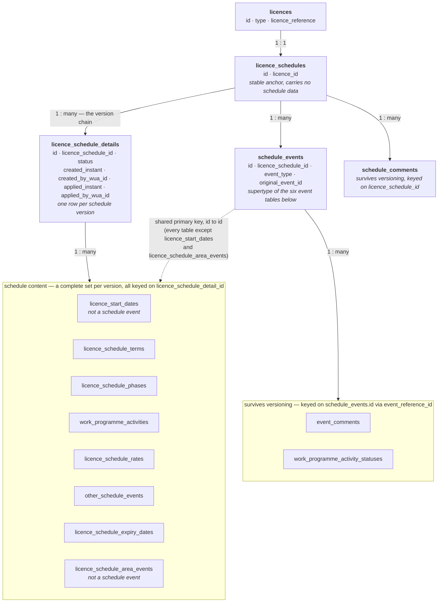

# Licence Schedules — Data Model, Creation and Update Behaviour

How the Licensing Management Service (LMS) stores licence schedules, what happens
in the database when a schedule is created and when it is updated, and the enumerated values
that appear in the data.

This document describes the *database* behaviour only. It assumes no access to the LMS
codebase. All table and column names below are the live PostgreSQL names.

---

## 1. Vocabulary

| Term | Meaning |
|---|---|
| **Licence** | An energy licence, sourced from PEARS/the Energy Portal. Lives in `licences`. Integer PK. |
| **Schedule** | The set of commitments and dates attached to a licence — terms, phases, work programme activities, rental rates, expiry. One schedule per licence. |
| **Schedule version** (a.k.a. *schedule detail*) | A complete point-in-time snapshot of the whole schedule. A licence's schedule accumulates one row per version. Lives in `licence_schedule_details`. |
| **Schedule event** | Any dated item within a schedule version — a term, a phase, a work programme activity, a rate, an "other" event, or the expiry date. |
| **Term** | A major licence period — production: Initial, Second, Third, and a historic Fourth on the few schedules that have one; carbon storage: Appraisal, Operational, Post Closure Period (§7.3). |
| **Phase** | A subdivision of the production Initial term (Phase A/B/C). Carbon storage schedules have no phases (§7.4). |
| **Work programme activity (WPA)** | A committed piece of work with a due date (drill a well, shoot seismic, etc.). |

The single most important structural fact: **LMS never edits a live schedule in place.
Every change produces a brand-new set of rows for the entire schedule.** §5 explains how that
works; §10 collects the practical consequences.

---

## 2. How the tables fit together

```
licences (id INTEGER)
   │  1 : 1
   ▼
licence_schedules (id UUID, licence_id)
   │  1 : many  ← one row per *version* of the schedule
   ▼
licence_schedule_details (id UUID, licence_schedule_id, status, created_instant, created_by_wua_id,
                          applied_instant, applied_by_wua_id)
   │  1 : many  ← the actual content, re-created per version
   ▼
licence_start_dates, licence_schedule_terms, licence_schedule_phases,
work_programme_activities, licence_schedule_rates, other_schedule_events,
licence_schedule_expiry_dates, licence_schedule_area_events
```

- `licence_schedules` is a thin stable anchor. It exists so that things which must outlive
  an individual version — event comments and work programme activity statuses (§6) — have
  something permanent to point at. It carries no data beyond `licence_id`. A licence has
  **at most one** row here; this is enforced in application code, not by a database unique
  constraint.
- `licence_schedules.licence_id` is the join key back to `licences`. `licences` also carries
  `type`, `subtype`, `prefix`, `licence_number`, `licence_reference`, `round_issued_on` and
  `end_date` — see `licences-and-responsible-organisations-data-model.md`, which also covers
  licence status and the organisations responsible for a licence.
- `licence_schedule_details` is the version table. Its `status` column drives everything
  (§4).
- Every child table carries `licence_schedule_detail_id` — i.e. child rows belong to **one
  specific version**, never to the schedule as a whole.

### 2.1 Entity relationship diagram

Read top to bottom: each layer is keyed on the layer above it.



Two of the eight content tables hold **at most one row per version** — `licence_start_dates`
and `licence_schedule_expiry_dates`. The other six hold many, so the single `1 : many` edge
into the content layer is a simplification on that point.

### 2.2 `licence_schedule_area_events`

Retention, development and pre-producing area events, held **as PEARS holds them**: `RD` events
on onshore licences (retention or development areas) and `PA` events on offshore licences
(pre-producing areas). LMS doesn't manage these areas yet, so they are kept as plain rows against
a schedule version rather than as schedule events:

- Rows are only written by the PEARS schedule migration, one per `RD`/`PA` event in each
  migrated PEARS version, against that version's detail. No LMS screen adds, edits or deletes
  them yet. Licences migrated without area events, and schedules created in LMS, have none.
- Like `licence_start_dates`, they have **no `schedule_events` row**, so no `original_event_id`,
  no `event_comments` rows (§6.1) and no event tracker entry. PEARS's comments on the event are
  held in the row's own `comments` column instead.
- They are **copied with the rest of the version** when a draft is created (§5.2).
- `event_date` is the date PEARS holds, not one LMS works out: there is no duration or anchor.
- `subtype`, the `area_*` columns and `pears_event_id` (PEARS's `EVENT_ID`, held as text) are
  null on older hand-entered `PA` events, which PEARS holds without them.
- The timeline shows them, read-only, under their own filter, "Retention, development and
  pre-producing areas" (`ScheduleEventType.AREA`). Each one sits in the term or phase its
  `event_date` falls in, as other dated events do. An area can sit outside the terms, as when it
  carries on after a licence's last term, so one dated after the last term is shown in its own
  section, "After the …" that term. The heading is the area name and its short name,
  with `v` and the version from version 2 on (`Area one (A1v2)`), as PEARS shows it. A hand-entered
  event with no area is headed "Pre-producing area". Below the heading is the area type, from
  `area_type` ("Retention area", "Development area" or "Pre-producing area"; from `event_mnem` when
  there is no type), left out where the heading already says it. The body is the event's `comments`.

| Column | Meaning |
|---|---|
| `event_mnem` | `RD` (onshore) or `PA` (offshore) |
| `subtype` | `APPROVAL`, `EXPIRY`, `WORK_PROGRAMME` or `END`; nullable |
| `event_date` | The event's date in PEARS |
| `comments` | PEARS's comments, e.g. "Approval: 01-12-2021" |
| `area_name`, `area_short_name`, `area_type`, `area_version` | The area the event is about. `area_type` is `RETENTION` or `DEVELOPMENT` onshore, `PROSPECTIVE` offshore |
| `pears_event_id` | PEARS's `EVENT_ID`, kept for writing the events back to PEARS |

The diagram also omits the foreign keys *within* the content layer, which would obscure the
top-down shape. They are:

| From | To | Column |
|---|---|---|
| `licence_schedule_phases` | `licence_schedule_terms` | `licence_schedule_term_id` (parent term) |
| `work_programme_activities` | `licence_schedule_terms` / `licence_schedule_phases` | `licence_schedule_term_id` / `licence_schedule_phase_id` |
| `licence_schedule_rates` | `licence_schedule_terms` / `licence_schedule_phases` | `licence_schedule_term_id` / `licence_schedule_phase_id` |
| `other_schedule_events` | `licence_schedule_terms` / `licence_schedule_phases` | `licence_schedule_term_id` / `licence_schedule_phase_id` |

In all four cases the target row belongs to the **same schedule version** as the source row —
these references never cross between versions (§5.2).

### 2.3 PEARS schedule migration tables

Four tables only the PEARS schedule migration uses. They are made by hand-run scripts
(`manualscripts/pearsschedulemigration`), not Flyway, in each environment the migration runs in, so
other environments don't have them. Nothing else in LMS reads them.

| Table | One row per | Used for |
|---|---|---|
| `pears_schedule_event_migration_links` | Migrated schedule event | The PEARS event it came from, for the comparison report and the write-back |
| `pears_schedule_migrated_licences` | Schedule the migration created | Telling migrated schedules from ones made in LMS; only these are cleared down (§5.3a) |
| `pears_schedule_migration_runs` | Run | A migration, cleardown or dry run, and how far it has got. Only one is queued or running at a time (a unique partial index) |
| `pears_schedule_migration_queue` | Licence in a run | What happened to the licence in that run |

| Column | Meaning |
|---|---|
| `pears_schedule_event_migration_links.schedule_event_id` | The LMS event (`schedule_events.id`) |
| `pears_schedule_event_migration_links.pears_plsd_id` | The PEARS schedule version it came from (`PED_LICENCE_SCHEDULE_DETAILS.ID`) |
| `pears_schedule_event_migration_links.pears_event_mnem`, `pears_event_index` | The PEARS event's type and its position in that version's event list, from 1 |
| `pears_schedule_event_migration_links.pears_event_id` | PEARS's `EVENT_ID`, where it has one |
| `pears_schedule_migrated_licences.licence_schedule_id`, `licence_id` | The migrated schedule and its licence |
| `pears_schedule_migrated_licences.run_id`, `migrated_at` | The run that migrated it, and when |
| `pears_schedule_migration_runs.kind` | `MIGRATE`, `CLEARDOWN` or `VALIDATE` (a dry run) |
| `pears_schedule_migration_runs.status` | `QUEUED`, `RUNNING`, `COMPLETE` or `CANCELLED` |
| `pears_schedule_migration_runs.requested_by`, `requested_at`, `completed_at` | Who started the run (a WUA id), when, and when it finished |
| `pears_schedule_migration_queue.run_id`, `licence_reference` | The run, and the licence as PEARS names it, e.g. `P1556` |
| `pears_schedule_migration_queue.status` | `PENDING` until worked, then `MIGRATED`, `CLEARED`, `MATCHED` or `DIFFERS` (dry run), `SKIPPED` or `FAILED` |
| `pears_schedule_migration_queue.attempts` | How many times the licence has been worked, retries included |
| `pears_schedule_migration_queue.outcome` | Why it was skipped or failed, or a dry run's first issues; null while pending |
| `pears_schedule_migration_queue.notes` | JSON counts of the migration's notes by reason, and a dry run's comparison results; null while pending |
| `pears_schedule_migration_queue.started_at`, `finished_at` | The last attempt; null while pending |

---

## 3. `schedule_events` — the shared supertype table

This is the part most likely to trip up a query written from table names alone.

All six schedule event types — terms, phases, work programme activities, rates, other events
and expiry — are stored using **joined-table inheritance**. There is a parent table,
`schedule_events`, and each event type has its own child table. The child table's `id` is
**both its primary key and a foreign key to `schedule_events.id`** — the two rows share the
same UUID.

```
schedule_events
  id                  UUID PK
  licence_schedule_id UUID NOT NULL  → licence_schedules.id
  event_type          TEXT NOT NULL  ← discriminator, see §7.2
  original_event_id   UUID NOT NULL  ← see §5.2
```

Retrieving a complete term requires joining both tables:

```sql
SELECT se.event_type, se.original_event_id, t.*
FROM licence_schedule_terms t
JOIN schedule_events se ON se.id = t.id
WHERE t.licence_schedule_detail_id = :detail_id;
```

`schedule_events` holds one row per child row **per version**. Duplicating a schedule
version duplicates the `schedule_events` rows too, each with a fresh `id`.

Notes:

- `licence_start_dates` is **not** part of this hierarchy — it has no `schedule_events` row.
- `event_type` is redundant with "which child table holds the row", but it is populated and
  reliable, so it is safe to use for filtering `schedule_events` without joining out.
- The child tables have **no separate foreign key column** to `schedule_events` — the link is
  `id` to `id`. The two *satellite* tables (§6) do have an explicit foreign key column, and it
  is named `event_reference_id`, pointing at `schedule_events.id`.

---

## 4. Schedule version status — `licence_schedule_details.status`

Stored as `TEXT`. Values:

| Value | Meaning |
|---|---|
| `DRAFT` | Being built or edited. Not visible as the licence's schedule. Only one draft is expected per licence at a time. |
| `ACTIVE` | The current, live schedule for the licence. **At most one per licence** — enforced in application code, not by a database constraint. |
| `REPLACED` | A previously active version, superseded by a newer one. Retained for history. |
| `DELETED` | A draft that was abandoned. **The rows are not physically deleted** — the status is flipped and everything stays in place. |

**For any "what is the schedule right now" query, filter to `status = 'ACTIVE'`.**
For "what did the schedule look like historically", `ACTIVE` and `REPLACED` rows ordered by
`applied_instant` form the version chain. `DRAFT` and `DELETED` must be excluded from published
reporting — `DRAFT` is unapproved work in progress and `DELETED` is abandoned work.

### 4.1 Who created and applied a version, and when

| Column | Set when | Null when |
|---|---|---|
| `created_instant` | The version's row is inserted — for a version built in LMS, that is when its draft was started | Never, for any row the service writes |
| `created_by_wua_id` | The version's row is inserted — the Energy Portal wua id of the user who started the draft | Older versions, which predate it being recorded |
| `applied_instant` | The version moves `DRAFT → ACTIVE` | The version is `DRAFT`, or is `DELETED` (it was abandoned without ever being applied) |
| `applied_by_wua_id` | The version moves `DRAFT → ACTIVE` — the wua id of the user who applied it | As `applied_instant`, and also on older versions, which predate it being recorded |

`applied_instant` and `applied_by_wua_id` are not cleared when a version later moves to
`REPLACED`, so a `REPLACED` row still records when it went live and who applied it. The rule
that only `ACTIVE` and `REPLACED` rows carry them is enforced in application code, not by a
database constraint.

| Version origin | `applied_instant` | `created_by_wua_id` and `applied_by_wua_id` |
|---|---|---|
| Built and applied in LMS | When the user applied the draft | The users who started and applied the draft — not necessarily the same person |
| Migrated from PEARS or carbon storage | Equal to `created_instant`. These rows are inserted already `ACTIVE` or `REPLACED` and carry their historical date in `created_instant`, so there is no separate apply step to date. | Both `1`, a placeholder meaning "written by the migration" rather than a real user |

### 4.2 Status transitions

```
   (user creates or updates a schedule)
                │
                ▼
              DRAFT ──────── abandon ────────► DELETED
                │
                │ apply
                ▼
              ACTIVE ─── a newer version is applied ───► REPLACED
```

---

## 5. Creation and update, step by step

### 5.1 Creating a schedule for the first time

Triggered when a Licence Management user starts the "Create a new licence schedule" journey
and submits the licence start date. In database terms:

1. A `licence_schedules` row is created for the licence if one does not already exist
   (`licence_id` set, nothing else).
2. A `licence_schedule_details` row is inserted with `status = 'DRAFT'`,
   `created_instant = now()` and `created_by_wua_id` set to the user.
3. A `licence_start_dates` row is inserted against that detail, holding the licence start date.
4. The user then adds terms, phases, work programme activities, rates and other events one at
   a time. Each add/edit/delete writes to the relevant child table (plus a `schedule_events`
   row for the event types listed in §3) and **immediately triggers a full recalculation of
   all derived dates for that version** (§5.4).
5. When the user chooses "Apply", the detail's `status` moves `DRAFT → ACTIVE`,
   `applied_instant` is set to now and `applied_by_wua_id` to the applying user. Because there was no prior active version, nothing is set
   to `REPLACED`.

### 5.2 Updating an existing schedule — copy, edit, apply

LMS has no in-place edit path for a live schedule. An update is:

1. **Copy.** The user starts "Update an existing licence schedule". The system takes the
   current `ACTIVE` detail and creates a **new** `licence_schedule_details` row with
   `status = 'DRAFT'`, `created_instant = now()`, `created_by_wua_id` set to the user, and
   `applied_instant` and `applied_by_wua_id` null, pointing at the same `licence_schedule_id`.
   None of the old detail's dates or users are carried across.
2. Every child row of the old detail is **copied field-for-field** into new rows attached to
   the new detail. This applies to all eight child tables: `licence_start_dates`,
   `licence_schedule_terms`, `licence_schedule_phases`, `work_programme_activities`,
   `licence_schedule_rates`, `other_schedule_events`, `licence_schedule_expiry_dates`,
   `licence_schedule_area_events`.
   - Every copied row gets a **new `id`**. All other columns — including
     `licence_schedule_id` and `original_event_id` — are carried over unchanged.
   - Internal cross-references are then re-pointed: a copied phase's
     `licence_schedule_term_id` is rewritten to the *new* term row, matched by `term_type`.
     The same re-pointing happens for rates, work programme activities and other events
     (matched on `term_type` / `phase_type`).
3. **Edit.** The user changes the new draft. Adds insert rows; edits update rows in place
   *within the draft*; deletes physically `DELETE` rows from the draft's child tables.
   The old `ACTIVE` version is untouched throughout.
4. **Apply.** On apply:
   - the previous `ACTIVE` detail is set to `REPLACED`, keeping its `applied_instant` and
     `applied_by_wua_id`;
   - the draft detail is set to `ACTIVE`, with `applied_instant` set to now and
     `applied_by_wua_id` to the applying user;
   - any `PENDING` event comments on this schedule are promoted to `PUBLISHED` (§6.1).

**Tracking one logical event across versions: `original_event_id`.**
Because each version gets fresh `id`s, `schedule_events.id` cannot be used to follow "the
same" activity through time. `schedule_events.original_event_id` exists for exactly that.
On first insert it is set equal to the row's own `id`; on every subsequent copy it is carried
across untouched. So all versions of one logical schedule event share one
`original_event_id`, and the *earliest* version of that event has `id = original_event_id`.

```sql
-- Follow one work programme activity through every schedule version
SELECT lsd.status, lsd.created_instant, wpa.category, wpa.commitment, wpa.due_date
FROM work_programme_activities wpa
JOIN schedule_events se ON se.id = wpa.id
JOIN licence_schedule_details lsd ON lsd.id = wpa.licence_schedule_detail_id
WHERE se.original_event_id = :original_event_id
ORDER BY lsd.created_instant;
```

Caveat: an event that was *added* in a later version has no row in earlier versions, and one
that was *deleted* in a later version has no row in later ones. `original_event_id` groups
rows; it does not guarantee one row per version.

### 5.3 Deleting a draft

The draft detail is set to `status = 'DELETED'`. Its child rows remain in place. Pending
comments for that schedule are removed. Nothing is physically deleted except the child rows
the user explicitly deleted while editing.

### 5.3a Clearing down a migrated schedule (outside production only)

The one place whole schedules are physically deleted. To let the PEARS schedule migration run
again in a non-production environment, its cleardown deletes every schedule listed in
`pears_schedule_migrated_licences`: every version and event, comments, work programme activity
statuses, schedule comments, area events, start dates, the PEARS link rows, and the schedule's reminders,
missing-contact reports and event tracker rows ([reminders](licence-schedule-reminders-data-model.md),
[event cache](licence-event-cache-data-model.md)). Its audit history goes too (§9), including that
of events users had deleted, so a re-run leaves no history of the old schedule.

The licence and everything else about it stay. Schedules LMS created itself have no
`pears_schedule_migrated_licences` row and are never touched. Environments are reset before a
migration, so no application references a migrated schedule; if one did, its foreign key would
stop that licence's cleardown. It is off unless `pears.schedule-migration.cleardown-enabled` is
set, which it never is in production.

### 5.4 Derived dates — what is stored versus what is calculated

Dates are **recalculated and re-persisted for the entire version** on every single add, edit
or delete within a draft, and again immediately after a version is copied. The rules:

| Table / column | How it is derived |
|---|---|
| `licence_schedule_terms.start_date` | First term starts on `licence_start_dates.start_date`. Each subsequent term — in the term sequence for the licence type (§7.3) — starts the day after the previous term's `end_date`. |
| `licence_schedule_terms.end_date` | `start_date` + `term_duration_years`/`_months`/`_days`. If years or months are non-zero, one day is subtracted (so a "5 year" term runs to the day before the fifth anniversary). Pure-day durations are not adjusted. |
| `licence_schedule_phases.start_date` / `end_date` | Same arithmetic, chained within the parent term, starting at the term's `start_date`. |
| `work_programme_activities.due_date` | **Only populated when `date_option = 'RELATIVE_DATE'`** (= anchor date + `relative_duration_*`). For `WITHIN_A_TERM` / `WITHIN_A_PHASE` the column is left null and the effective due date is the linked term's or phase's `end_date`. |
| `other_schedule_events.event_date` | Same rule as `due_date` above — only populated for `date_option = 'RELATIVE_DATE'`. |
| `licence_schedule_rates.start_date` | `TERM` → the term's start date. `PHASE` → the phase's start date. `CUSTOM_PERIOD` → the anchor's start date (`ON_START_DATE`) or anchor + `relative_duration_*` (`RELATIVE_TO_START_DATE`). |
| `licence_schedule_rates` end date | **Not stored.** Derived at display time from the start date of the next rate in the ordered sequence. |
| `licence_schedule_expiry_dates.expiry_date` | Entered by the user, not calculated. |

**Reporting consequence:** an activity's due date cannot be read from `due_date` alone. Use:

```sql
COALESCE(
  wpa.due_date,   -- RELATIVE_DATE
  ph.end_date,    -- WITHIN_A_PHASE
  tm.end_date     -- WITHIN_A_TERM
) AS effective_due_date
```

with left joins to `licence_schedule_phases ph` and `licence_schedule_terms tm`.

"Current term/phase" is evaluated as `start_date <= today AND end_date > today` — **start
inclusive, end exclusive**.

---

## 6. Data that deliberately survives versioning

Two tables hang off `schedule_events` and one off `licence_schedules` rather than off a schedule
version, so their history is not lost when a new version is created. **None is copied during
versioning.**

Two further tables outside this document also reach into the schedule this way and are worth
knowing about before writing a query that joins on `schedule_events` or `original_event_id` —
`licence_reminders` (`licence-schedule-reminders-data-model.md`) and `licence_event_cache`
(`licence-event-cache-data-model.md`). Neither holds schedule content.

### 6.1 `event_comments`

```
id                 UUID PK
event_reference_id UUID NOT NULL  → schedule_events.id
comment            TEXT
status             TEXT           ← PENDING | PUBLISHED
timestamp          TIMESTAMPTZ
author_wua_id      INTEGER        ← Energy Portal web user account id
```

- `PENDING` — a comment written against a draft, not yet visible on the licence. Promoted to
  `PUBLISHED` when the draft is applied; hard-deleted if the draft is deleted.
- `PUBLISHED` — visible. Comments added directly against a live schedule are inserted as
  `PUBLISHED`.
- A comment points at one specific `schedule_events` row, i.e. one version. To assemble the
  full comment history for a logical event, group by `original_event_id`:

```sql
SELECT se.original_event_id, ec.timestamp, ec.author_wua_id, ec.comment
FROM event_comments ec
JOIN schedule_events se ON se.id = ec.event_reference_id
WHERE ec.status = 'PUBLISHED' AND se.licence_schedule_id = :licence_schedule_id
ORDER BY se.original_event_id, ec.timestamp;
```

- Only one `PENDING` comment per `original_event_id` is possible at a time.
- `author_wua_id` is an external Energy Portal identifier. Names are not stored in LMS — they
  are resolved from the Energy Portal at render time. Author names are therefore only
  obtainable by resolving `wua_id` against the Portal.

### 6.2 `work_programme_activity_statuses`

```
id                     UUID PK
event_reference_id     UUID NOT NULL  → schedule_events.id
status                 TEXT           ← see §7.7
applied_datetime       TIMESTAMPTZ
licence_transferred_to INTEGER        → licences.id (nullable)
```

**This is an append-only status ledger, not a current-state column.** A new row is inserted
on every status change; nothing is updated. The current status of an activity is the row with
the greatest `applied_datetime` for that activity's `original_event_id`:

```sql
SELECT DISTINCT ON (se.original_event_id)
       se.original_event_id, s.status, s.applied_datetime, s.licence_transferred_to
FROM work_programme_activity_statuses s
JOIN schedule_events se ON se.id = s.event_reference_id
ORDER BY se.original_event_id, s.applied_datetime DESC;
```

- Every new work programme activity gets an initial `OPEN` row on creation, unless a status
  row already exists for its `original_event_id` (which is the case for a copied activity —
  the existing ledger is simply reused).
- `licence_transferred_to` is populated only for the `TRANSFERRED` status, naming the licence
  the commitment moved to.
- Deleting a work programme activity from a draft removes its status ledger **only if that
  activity was the last remaining `work_programme_activities` row carrying that
  `original_event_id`** across all versions. While any other version still holds the
  activity, the ledger stays.

### 6.3 `schedule_comments`

```
id                  UUID PK
licence_schedule_id UUID NOT NULL  → licence_schedules.id
comment             TEXT NOT NULL
timestamp           TIMESTAMPTZ NOT NULL
author_wua_id       INTEGER        ← Energy Portal web user account id (nullable)
```

Comments on the schedule as a whole rather than on one event, such as PEARS general notes. They
belong to the licence's schedule, not to a version, so they have no status: every row is visible
to regulators on the licence's schedule tab and read-only on the draft timeline. Schedule and work
programme administrators can remove them from the schedule tab at any time (a physical delete).
There is no screen to add one; they come from the PEARS work programme migration.

- A null `author_wua_id` shows a blank author. Migrated comments carry the PEARS author's name
  in the comment text instead.

---

## 7. Enumerated values

All enums are persisted as their **Java constant name in a `TEXT` column** — no numeric codes,
no lookup tables, no database `CHECK` constraints or `ENUM` types. The display strings below
are what LMS shows in its own UI; they are held in code and are **not** present in the
database. There is nothing at the database level preventing an unexpected value, so the lists
below describe what the service writes rather than what the schema guarantees — a value
outside them is a data-quality signal, not a documentation gap.

### 7.1 `licence_schedule_details.status`

`DRAFT`, `ACTIVE`, `REPLACED`, `DELETED` — see §4.

### 7.2 `schedule_events.event_type`

| Value | Child table |
|---|---|
| `TERM` | `licence_schedule_terms` |
| `PHASE` | `licence_schedule_phases` |
| `WORK_PROGRAMME_ACTIVITY` | `work_programme_activities` |
| `RATE` | `licence_schedule_rates` |
| `OTHER` | `other_schedule_events` |
| `EXPIRY` | `licence_schedule_expiry_dates` |

### 7.3 `licence_schedule_terms.term_type`

| Value | Display | Applies to licence types |
|---|---|---|
| `INITIAL` | Initial Term | Landward production, Seaward production |
| `SECOND` | Second Term | Landward production, Seaward production |
| `THIRD` | Third Term | Landward production, Seaward production |
| `FOURTH` | Fourth Term | Landward production, Seaward production — **historic**, see below |
| `APPRAISAL` | Appraisal Term | Carbon storage |
| `OPERATIONAL` | Operational Term | Carbon storage |
| `POST_CLOSURE_PERIOD` | Post Closure Period | Carbon storage |
| `INITIAL_CS` | Initial Term | Carbon storage — **historic data only**, see below |

**Term sequences.** Terms are ordered by a fixed rank held against each value, not by any
column in the database. The live sequences are:

- **Production** (landward and seaward): Initial → Second → Third, and → Fourth on the few
  schedules that have one
- **Carbon storage**: Appraisal → Operational → Post Closure Period

**`FOURTH` is historic.** A small number of older production licences (13 seaward licences from
the 2004–2009 rounds, in PEARS) have a fourth term, and only those schedules keep it. It can be
added to a schedule version only when the licence's `ACTIVE` version already has a `FOURTH`
term: a draft can keep, edit, or remove and re-add its Fourth term, but no other schedule is
offered one. Once a version without a Fourth term is applied, the licence can't have one again.
It ranks after `THIRD`, so ordering terms by rank needs no special handling.

**`INITIAL_CS` is not part of the current carbon storage sequence.** It exists to carry
carbon storage term data that originated as an "Initial" term in the source records, and is
only found on those schedules. Do not model it as a stage every carbon storage licence passes
through.

Critically, **`INITIAL_CS` appears *in place of* the Appraisal term, not in addition to it.**
A carbon storage schedule has one first term or the other, never both. So the two shapes a
carbon storage schedule can take are:

- Appraisal → Operational → Post Closure Period
- Initial → Operational → Post Closure Period  *(where `INITIAL_CS` is present)*

`INITIAL_CS` ranks after `APPRAISAL` and before `OPERATIONAL`, so ordering terms by rank
resolves either shape correctly without special handling — the Appraisal rank is simply
unoccupied on the schedules that use `INITIAL_CS`.

This gives a checkable invariant: every carbon storage schedule version holds exactly one of
`APPRAISAL` or `INITIAL_CS`, and a version carrying both is malformed.

Note also that `INITIAL` and `INITIAL_CS` share the display text "Initial Term" but are
distinct values belonging to different licence families, so do not join or group on the
display text. `INITIAL_CS` also remains a selectable term option for carbon storage licences
rather than being blocked at the point of entry; which schedules legitimately use it is for
the NSTA to manage.

### 7.4 `licence_schedule_phases.phase_type`

| Value | Display | Parent term |
|---|---|---|
| `PHASE_A` | Phase A | `INITIAL` |
| `PHASE_B` | Phase B | `INITIAL` |
| `PHASE_C` | Phase C | `INITIAL` |

Phases exist only within the production `INITIAL` term — not the carbon storage `INITIAL_CS`,
despite the shared display text (§7.3). **Carbon storage schedules have no phases at all**, so
a phase row on a carbon storage licence is anomalous, as is a phase under any term other than
`INITIAL`.

### 7.5 `work_programme_activities.category`

| Value | Display | Applies to licence types |
|---|---|---|
| `ASSESS_PRE_FEED_PLAN` | Assess pre feed plan | Carbon storage |
| `DRILLING_WELL` | Drilling Well | Carbon storage |
| `DRILL_OR_DROP_WELL` | Drill or drop well | Seaward / Landward production |
| `DRILL_WELL` | Drill well | Seaward / Landward production |
| `EARLY_RISK_ASSESSMENT` | Early risk assessment | Carbon storage |
| `EARLY_RISK_ASSESSMENT_FURTHER_MEASURES` | Early risk assessment further measures | Carbon storage |
| `EARLY_RISK_ASSESSMENT_WORKSHOP` | Early risk assessment workshop | Carbon storage |
| `END_ASSESS_PHASE_REVIEW` | End assess phase review | Carbon storage |
| `END_DEFINE_PHASE_REVIEW` | End define phase review | Carbon storage |
| `NEW_SHOOT_2_D_SEISMIC_DATA` | New shoot 2D seismic data | Seaward / Landward production |
| `NEW_SHOOT_3_D_SEISMIC_DATA` | New shoot 3D seismic data | Seaward / Landward production |
| `OBTAIN_EXISTING_2_D_SEISMIC_DATA` | Obtain existing 2D seismic data | Seaward / Landward production |
| `OBTAIN_EXISTING_3_D_SEISMIC_DATA` | Obtain existing 3D seismic data | Seaward / Landward production |
| `REPROCESS_SEISMIC_DATA` | Reprocess seismic data | Seaward / Landward production |
| `SEISMIC_ACQUISITION_AND_PROCESSING` | Seismic acquisition and processing | Carbon storage |
| `SEISMIC_REPROCESSING_AND_INTERPRETATION` | Seismic reprocessing and interpretation | Carbon storage |
| `SITE_CHARACTERISATION_REVIEW_REPORT` | Site characterisation review report | Carbon storage |
| `STORAGE_PERMIT_APPLICATION` | Storage permit application | Carbon storage |
| `WELL_INVESTMENT_ENGAGEMENT` | Well investment engagement | Carbon storage, Seaward / Landward production |
| `WELL_TEST` | Well test | Carbon storage, Seaward / Landward production |
| `OTHER_ACTIVITY` | Other activity | Carbon storage, Seaward / Landward production, Gas storage |

When `category = 'OTHER_ACTIVITY'`, the user-entered free-text name is in
`other_category_name` and **that** is the label used in the UI. For all other categories
`other_category_name` should be null. So:

```sql
CASE WHEN wpa.category = 'OTHER_ACTIVITY'
     THEN wpa.other_category_name
     ELSE wpa.category
END AS activity_label
```

### 7.6 `work_programme_activities.commitment`

| Value | Display |
|---|---|
| `FIRM` | Firm |
| `CONTINGENT` | Contingent |
| `CONDITIONAL` | Conditional |

### 7.7 `work_programme_activity_statuses.status`

| Value | Display |
|---|---|
| `OPEN` | Open |
| `IN_PROGRESS` | In progress |
| `COMPLETE` | Complete |
| `FULL_WAIVER` | Full waiver |
| `TRANSFERRED` | Transferred |
| `DROPPED` | Dropped (not drilled) — the drill-or-drop decision was to drop rather than drill. Can only be chosen for a `DRILL_OR_DROP_WELL` or `OTHER_ACTIVITY` activity |

### 7.8 `work_programme_activities.date_option` and `other_schedule_events.date_option`

Both columns use the same value set.

| Value | Display | Effect on the row |
|---|---|---|
| `WITHIN_A_TERM` | Within a licence term | `licence_schedule_term_id` set, `licence_schedule_phase_id` null, date column null |
| `WITHIN_A_PHASE` | Within a licence phase | `licence_schedule_phase_id` set, `licence_schedule_term_id` null, date column null |
| `RELATIVE_DATE` | A date relative to another schedule event | Anchored to a term or phase, `relative_duration_*` populated, date column calculated and stored |

### 7.9 `licence_schedule_rates.rate_definition_option`

| Value | Display | Effect on the row |
|---|---|---|
| `TERM` | Term | `licence_schedule_term_id` set; `start_date` = term start |
| `PHASE` | Phase | `licence_schedule_phase_id` set; `start_date` = phase start |
| `CUSTOM_PERIOD` | Custom period relative to another schedule event | `rate_relative_date_option` and `relative_duration_*` used to derive `start_date` |

### 7.10 `licence_schedule_rates.rate_relative_date_option`

| Value | Display |
|---|---|
| `ON_START_DATE` | On the date of the event |
| `RELATIVE_TO_START_DATE` | On a date relative to the event |

Populated only when `rate_definition_option = 'CUSTOM_PERIOD'`.

### 7.11 `other_schedule_events.category`

| Value | Display | Applies to licence types |
|---|---|---|
| `MANDATORY_RELINQUISHMENT` | Mandatory relinquishment | Carbon storage, Seaward / Landward production, Gas storage |
| `OTHER_ACTIVITY` | Other activity | Carbon storage, Seaward / Landward production, Gas storage |

Same `other_category_name` rule as §7.5.

`relinquishment_percentage` is the percentage of the initial licensed area a mandatory
relinquishment relinquishes: 0 to 100, to 1 decimal place (`NUMERIC(4,1)`). It is only set when
`category = 'MANDATORY_RELINQUISHMENT'` and is null for all other categories. The form requires it
for mandatory relinquishments, but rows saved before it was added (and relinquishments migrated
from PEARS without one) are null.

### 7.12 `event_comments.status`

| Value | Meaning |
|---|---|
| `PENDING` | Written against a draft; not yet visible on the licence |
| `PUBLISHED` | Visible |

### 7.13 `licences.type`

Included because it drives which of the above values are legitimate for a given schedule.

| Value | Display | Reference prefix | Managed in LMS |
|---|---|---|---|
| `CARBON_STORAGE` | Carbon storage | `CS` | Yes |
| `GAS_STORAGE` | Gas storage | `GS` | Yes |
| `LANDWARD_EXPLORATION` | Landward exploration | `LX` | Yes |
| `LANDWARD_PRODUCTION` | Landward production | `PEDL`, `PL`, `EXL`, `ML`, `AL`, `CE`, `DL` | No |
| `METHANE_DRAINAGE` | Methane drainage | `MDL` | Yes |
| `SEAWARD_EXPLORATION` | Seaward exploration | `E` | Yes |
| `SEAWARD_PRODUCTION` | Seaward production | `P` | No |

Several PEARS reference prefixes share one type: `PEDL`, `PL`, `EXL`, `ML`, `AL`, `CE` and `DL`
licences are all `LANDWARD_PRODUCTION`. The original prefix is kept in `licences.prefix`, so
filter on that column to tell them apart.

`GAS_STORAGE`, `LANDWARD_EXPLORATION`, `METHANE_DRAINAGE` and `SEAWARD_EXPLORATION` are not yet available in the
service. A licence of these types can only be added while the future release phase is switched on, so expect
none in live data.

---

## 8. Duration columns

Terms, phases, work programme activities, rates and other events all store durations as
**three separate integer columns**, not as an interval:

| Table | Columns |
|---|---|
| `licence_schedule_terms` | `term_duration_years`, `term_duration_months`, `term_duration_days` |
| `licence_schedule_phases` | `phase_duration_years`, `phase_duration_months`, `phase_duration_days` |
| `work_programme_activities` | `relative_duration_years`, `relative_duration_months`, `relative_duration_days` |
| `licence_schedule_rates` | `relative_duration_years`, `relative_duration_months`, `relative_duration_days` |
| `other_schedule_events` | `relative_duration_years`, `relative_duration_months`, `relative_duration_days` |

These are calendar durations, not fixed day counts, so they cannot be flattened to a single
number of days without losing meaning.

Nullability differs by table:

- The three `licence_schedule_phases.phase_duration_*` columns are **`NOT NULL`** — they may be
  zero but never null.
- `licence_schedule_terms.term_duration_*` and every `relative_duration_*` column are
  **nullable**.

The `relative_duration_*` columns are only meaningful when the row's date option calls for
them; expect them null otherwise. The gate differs by table:

- `work_programme_activities` and `other_schedule_events` — meaningful only when
  `date_option = 'RELATIVE_DATE'` (§7.8).
- `licence_schedule_rates` — gated twice: `rate_definition_option = 'CUSTOM_PERIOD'` (§7.9)
  **and** `rate_relative_date_option = 'RELATIVE_TO_START_DATE'` (§7.10). Under
  `ON_START_DATE` the rate takes the anchor's own date and the duration columns are unused.

---

## 9. Audit history (Hibernate Envers)

Every schedule table has a parallel audit table with the suffix `_aud`
(`licence_schedule_details_aud`, `licence_schedule_terms_aud`, `schedule_events_aud`,
`work_programme_activities_aud`, and so on). Each holds the same data columns plus:

- `rev` — revision number, FK to `audit_revisions.rev`
- `revtype` — `0` = insert, `1` = update, `2` = delete

Revision metadata lives in one shared table:

```
audit_revisions
  rev               SERIAL PK
  created_date_time TIMESTAMPTZ
  user_wua_id       BIGINT      ← who made the change (Energy Portal wua id)
  proxy_user_wua_id BIGINT      ← set when acting on behalf of another user
```

Who created a version, and when and by whom it went live, are held directly on
`licence_schedule_details` (§4.1). The audit tables are the only place that records when a
version was replaced or deleted, and by whom:

```sql
SELECT ar.created_date_time, ar.user_wua_id, d.status
FROM licence_schedule_details_aud d
JOIN audit_revisions ar ON ar.rev = d.rev
WHERE d.id = :detail_id
ORDER BY d.rev;
```

---

## 10. Caveats and known gotchas

1. **`created_instant` is not an applied date — use `applied_instant`.**
   `licence_schedule_details.created_instant` is set when the *draft* is created; the gap
   before it is applied can be days or weeks. `applied_instant` is when it went live (§4.1). It
   is null for `DRAFT` and `DELETED` rows, so filter on `status` rather than relying on the
   null. For migrated versions the two columns are equal.
2. **"At most one `ACTIVE` per licence" is not a database constraint.** It is enforced only in
   application code, so it is an invariant to verify rather than one the schema guarantees.
3. **The individual event tables carry no status column.** `licence_schedule_terms`,
   `licence_schedule_phases`, `work_programme_activities`, `licence_schedule_rates` and
   `other_schedule_events` have no per-row status. The only event-level status in the model is
   the `work_programme_activity_statuses` ledger (§6.2), and it covers work programme
   activities only. Everything else takes its state from its parent
   `licence_schedule_details.status`.
4. **Commentary lives in `event_comments` and `schedule_comments`, with one exception.** The
   event tables have no `comments` column, except `licence_schedule_expiry_dates.comments`, which
   holds free text entered alongside the expiry date. Comments on one event are in
   `event_comments` (§6.1); comments on the schedule as a whole are in `schedule_comments` (§6.3).
5. **Row counts grow with every schedule change, not with every changed field.** A single
   correction to one activity's due date produces a complete new copy of every term, phase,
   activity, rate and event for that licence. Volume growth is driven by number of *schedule
   updates*, multiplied by schedule size.
6. **Deletes within a draft are physical.** If an activity is removed while a schedule is being
   updated, there is no tombstone in the child table — the row simply does not exist in the new
   version. Its absence relative to the previous version is the only evidence, plus the
   `_aud` table.
7. **`DELETED` versions are dead weight, not history.** They represent abandoned drafts that
   were never live. Exclude them; do not present them as a past state of the licence.
8. **User identifiers are external.** `author_wua_id`, `created_by_wua_id`, `applied_by_wua_id`,
   `user_wua_id` and `proxy_user_wua_id` are Energy Portal web user account ids. LMS stores no
   names or email addresses for them. On `licence_schedule_details`, the value `1` is a
   placeholder for versions written by the PEARS and carbon storage migrations (§4.1), not a
   real user.

---

## 11. Reference: current columns per table

The six schedule event tables — terms, phases, work programme activities, rates, other events
and expiry — each additionally join to `schedule_events` on `id` to reach
`licence_schedule_id`, `event_type` and `original_event_id` (§3). The other tables listed
below do not.

**`licence_schedule_details`**
`id`, `licence_schedule_id`, `status`, `created_instant`, `created_by_wua_id`, `applied_instant`,
`applied_by_wua_id`

**`licence_start_dates`** *(not a schedule event)*
`id`, `licence_schedule_detail_id`, `start_date`

**`licence_schedule_terms`**
`id`, `licence_schedule_detail_id`, `term_type`, `term_duration_days`, `term_duration_months`,
`term_duration_years`, `start_date`, `end_date`

**`licence_schedule_phases`**
`id`, `licence_schedule_detail_id`, `licence_schedule_term_id`, `phase_type`,
`phase_duration_days`, `phase_duration_months`, `phase_duration_years`, `start_date`, `end_date`

**`work_programme_activities`**
`id`, `licence_schedule_detail_id`, `category`, `other_category_name`, `description`,
`commitment`, `date_option`, `licence_schedule_term_id`, `licence_schedule_phase_id`,
`relative_duration_days`, `relative_duration_months`, `relative_duration_years`, `due_date`

**`licence_schedule_rates`**
`id`, `licence_schedule_detail_id`, `rate_definition_option`, `licence_schedule_term_id`,
`licence_schedule_phase_id`, `rate_relative_date_option`, `relative_duration_days`,
`relative_duration_months`, `relative_duration_years`, `start_date`, `rental_rate`

**`other_schedule_events`**
`id`, `licence_schedule_detail_id`, `category`, `other_category_name`,
`relinquishment_percentage` (§7.11), `description`, `date_option`, `licence_schedule_term_id`,
`licence_schedule_phase_id`, `relative_duration_days`, `relative_duration_months`,
`relative_duration_years`, `event_date`

**`licence_schedule_expiry_dates`**
`id`, `licence_schedule_detail_id`, `expiry_date`, `comments`

**`licence_schedule_area_events`** *(not a schedule event, §2.2)*
`id`, `licence_schedule_detail_id`, `event_mnem`, `subtype`, `event_date`, `comments`,
`area_name`, `area_short_name`, `area_type`, `area_version`, `pears_event_id`

**`schedule_events`**
`id`, `licence_schedule_id`, `event_type`, `original_event_id`

**`event_comments`**
`id`, `event_reference_id`, `comment`, `status`, `timestamp`, `author_wua_id`

**`work_programme_activity_statuses`**
`id`, `event_reference_id`, `status`, `applied_datetime`, `licence_transferred_to`

**`schedule_comments`**
`id`, `licence_schedule_id`, `comment`, `timestamp`, `author_wua_id`

**`pears_schedule_event_migration_links`** *(migration only, §2.3)*
`schedule_event_id`, `pears_plsd_id`, `pears_event_mnem`, `pears_event_index`, `pears_event_id`

**`pears_schedule_migrated_licences`** *(migration only, §2.3)*
`licence_schedule_id`, `licence_id`, `run_id`, `migrated_at`

**`pears_schedule_migration_runs`** *(migration only, §2.3)*
`id`, `kind`, `status`, `requested_by`, `requested_at`, `completed_at`

**`pears_schedule_migration_queue`** *(migration only, §2.3)*
`run_id`, `licence_reference`, `status`, `attempts`, `outcome`, `notes`, `started_at`, `finished_at`
