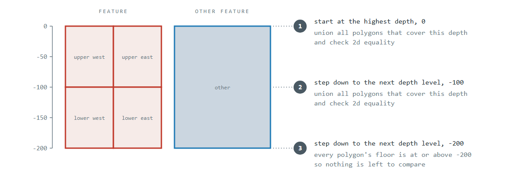
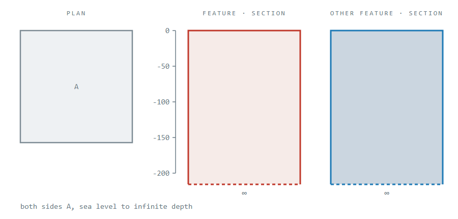
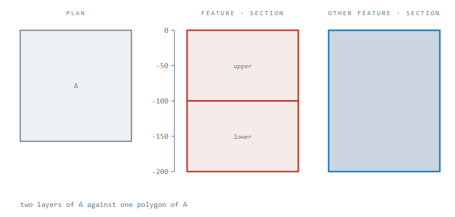
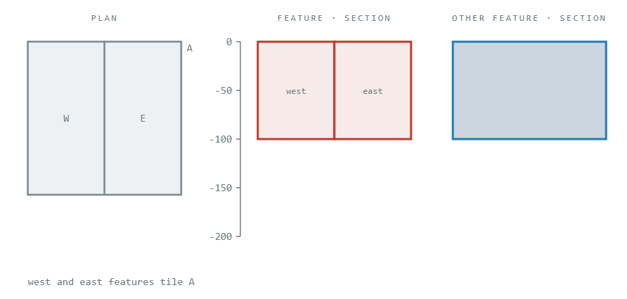
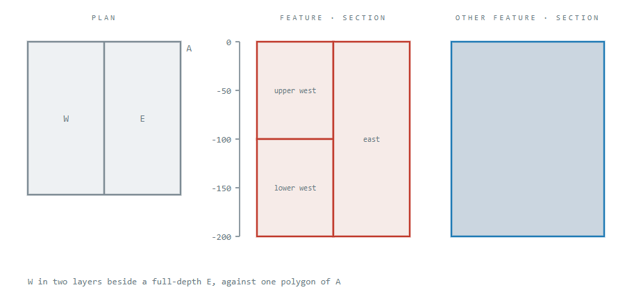
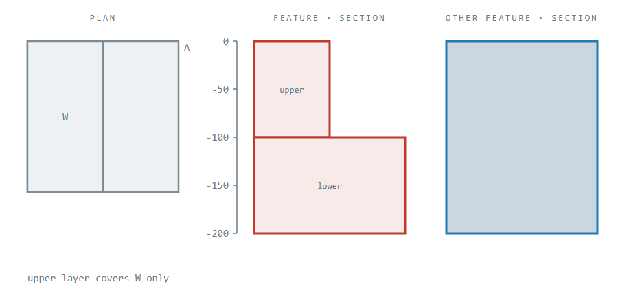
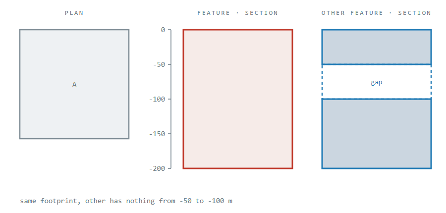
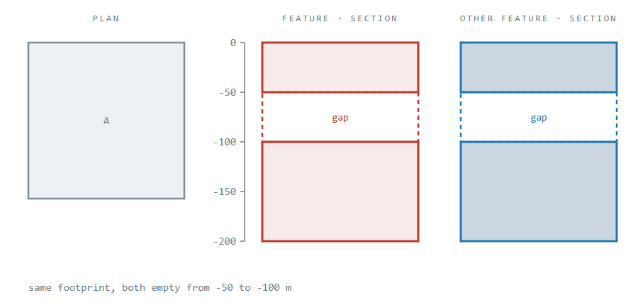
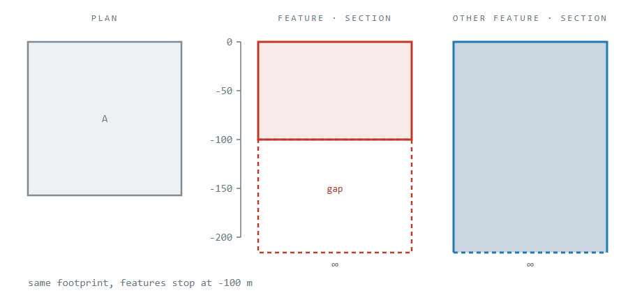

# Feature equality checks

## 2d spatial equality check

To check if two `features` are equal:

1. Gather the `polygons` for each feature and
2. Union each collection into single EsriJson Polygons with
   the [unionOperator](https://developers.arcgis.com/javascript/latest/references/core/geometry/operators/unionOperator/)
3. Use the Arc GIS JS
   SDK [equalsOperator](https://developers.arcgis.com/javascript/latest/references/core/geometry/operators/equalsOperator/) to
   check if two polygons are topologically equal.

### What is topological equality?

Two polygons are topologically equal if their shape is the same and in the same location regardless of the coordinate order in the
JSON or generalization of the geometry.

**Examples:**

**The extra vertices in B lie on A's edges, so they change how the polygon is generalized but not the shape it covers:**

```
Geometry A (4 vertices)                     Geometry B (8 vertices, a midpoint on each edge)

  (0,2)          (2,2)                           (0,2)    (1,2)    (2,2)
    +--------------+                               +--------+--------+
    |              |                               |                 |
    |              |          ===           (0,1)  +                 +  (2,1)
    |              |                               |                 |
    +--------------+                               +--------+--------+
  (0,0)          (2,0)                           (0,0)    (1,0)    (2,0)

Result: equalsOperator.execute(A, B) returns TRUE
```

**The order of coordinates stored in the JSON are sorted clockwise vs anti-clockwise for the same square:**

```
Geometry A (Starts Top-Left, Clockwise)      Geometry B (Starts Bottom-Right, Counter-Clockwise)

(Start) 1 --------> 2                       3 <-------- 2
        |           |                       |           |
        |           |           ===         |           |
        |           |                       |           |
        4 <-------- 3                       4 --------> 1 (Start)

Result: equalsOperator.execute(A, B) returns TRUE
```

**Polygons of the same size at different locations:**

```
Geometry A (At Coordinates 0,0)          Geometry B (At Coordinates 10,10)
                                        
   (0,1) +-------+ (1,1)                           (10,11) +-------+ (11,11)
         |       |                                         |       |
         |       |                  =/=                    |       |
         |       |                                         |       |
   (0,0) +-------+ (1,0)                           (10,10) +-------+ (11,10)

Result: equalsOperator.execute(A, B) returns FALSE
```

## 3d spatial equality check

### The algorithm



Equality follows the depth sweep in [3D shape processing](3d-shape-processing.md), which also covers how depths are
interpreted. The equality-specific parts are:

- **2D operation:** union each side's polygons covering this depth and compare the two shapes, exactly as the 2d check
  above does.
- **Depths checked:** every start and end depth of every polygon on either side, shallowest first. A change on either
  side can break equality, so the sweep runs once over both features rather than once per polygon.
- **Combining:** every depth must be equal. The first difference ends the check.
- **Empty slice:** a depth covered by neither side is skipped. That is either a gap both share or the deepest floor,
  which nothing covers. A depth covered by only one side means the features are not equal, and is settled without
  calling the node server.

The computation cost is one union and one equality check per depth that both sides cover.

### Test cases

#### No depths given at either end

`is3dTopologicallyEqual_whenAllDepthsNull_thenComparedOnce` — equal



Both sides run from sea level to infinite depth. Nothing covers infinite depth, so one comparison at sea level settles
it.

#### Layers matching a single polygon

`is3dTopologicallyEqual_whenLayeredFeaturesMatchSinglePolygon_thenTrue` — equal



The features split the shape into an upper and a lower layer that meet at -100 m. The first step compares the upper
layer with the other feature and the second compares the lower layer. Both match, and nothing covers -200 m.

#### Polygons at the same depth in different features

`is3dTopologicallyEqual_whenPolygonsAtSameDepthInDifferentFeatures_thenComparedTogether` — equal



A west and an east feature share the same depths and together tile A. They are unioned before the comparison, so
neither half has to match the other feature on its own.

#### A polygon spanning several layers

`is3dTopologicallyEqual_whenPolygonSpansSeveralLayers_thenUnionedIntoEachLayer` — equal



W is split into an upper and a lower layer that meet at -100 m, while E runs the full depth beside them. E is in both
slices: the step at 0 m unions upper W with E, and the step at -100 m unions lower W with E. Both match.

#### A difference in the first layer

`is3dTopologicallyEqual_whenFirstDepthNotEqual_thenFalseWithoutCheckingDeeper` — not equal



The upper layer covers only W while the other feature covers A, so the first comparison fails and the lower layer is
never checked.

#### A vertical gap on one side

`is3dTopologicallyEqual_whenOtherFeatureHasDepthGap_thenFalse` — not equal



The first step matches, but the other feature has nothing from -50 to -100 m, which the features cover.

#### The same vertical gap on both sides

`is3dTopologicallyEqual_whenBothHaveSameDepthGap_thenTrue` — equal



Both sides are empty from -50 to -100 m. The step at -50 m finds nothing on either side and moves on, and the layers
above and below the gap both match.

#### A bounded feature against an unbounded one

`is3dTopologicallyEqual_whenFeatureBoundedAndOtherFeatureInfinite_thenFalse` — not equal



The features stop at -100 m and the other feature has no floor. The step at 0 m matches, but below -100 m only the
other feature remains.

#### Rejected input

| Condition                                        | Result                     | Test                                                                            |
|--------------------------------------------------|----------------------------|---------------------------------------------------------------------------------|
| No features are given                            | `IllegalArgumentException` | `is3dTopologicallyEqual_whenNoFeatures_thenThrowsException`                     |
| The features are in different coordinate systems | `IllegalArgumentException` | `is3dTopologicallyEqual_whenFeatureCoordinateSystemDiffers_thenThrowsException` |

Both are rejected before any geometry is loaded, so a bad call costs nothing on the node server. Different coordinate
systems throw rather than return false because the equality check compares raw coordinates, which would make the
answer meaningless rather than merely imprecise.